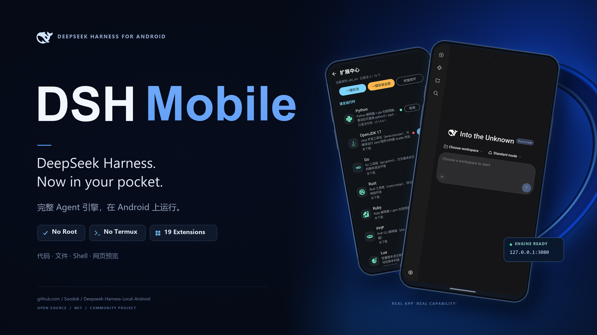

# DSH Mobile · DeepSeek Harness for Android

<p align="center">
  
</p>

<h3 align="center">别的移植项目给你一个能聊天的界面。<br>我们给你一台能写代码、能编译、能接管整台手机的工作站。</h3>

<p align="center">
  <b>原生启动 3.4 秒 · 容器启动 1.33 秒 · 108 条设备路由 · 1354 项权限声明<br>20 套工具链 · 真 clang / 真 JDK / 真 gradle</b>
</p>

<p align="center">
  <a href="#一快是两条路都快">① 启动快</a> ·
  <a href="#二手机不是聊天对象是执行对象">② 手机权限</a> ·
  <a href="#三手机上真的能编译">③ 编译环境</a> ·
  <a href="#-安装">安装</a> ·
  <a href="README_EN.md">English</a> ·
  <a href="README.de.md">Deutsch</a>
</p>

<p align="center">
  <i>有用户对比过同类项目后是这么说的：<br>
  「dsh go 界面挺好，但是没有编译环境和 root，根本没啥用。」</i>
</p>

<!-- 徽章区：左边看"有多少人在用"，右边看"项目是否健康"。 -->
[](https://github.com/Soodok/Deepseek-Harness-Local-Android/releases)
[](https://github.com/Soodok/Deepseek-Harness-Local-Android/stargazers)
[](https://github.com/Soodok/Deepseek-Harness-Local-Android/releases/latest)

[](https://github.com/Soodok/Deepseek-Harness-Local-Android/actions/workflows/android-build.yml)


[](https://github.com/Soodok/Deepseek-Harness-Local-Android/commits/main)
[](https://github.com/Soodok/Deepseek-Harness-Local-Android#%E5%8F%8D%E9%A6%88)
[](https://t.me/+4VN3pYyH6i8yNDA1)

---

## 三个数字，三件事

| | 我们 | 大多数同类项目 |
|---|---|---|
| **原生启动** | **3.4 秒**（低端 3 GB 手表也能跑） | 十几秒，或者直接起不来 |
| **Linux 容器启动** | **1.33 秒**，容器层只占 0.8% | 解压 rootfs，十几秒起 |
| **手机能力接入 Agent** | **108 条路由 / 23 个独立开关** | 一个聊天框 |
| **手机端编译** | **clang + JDK17 + gradle + cmake + rustc + go** | 无 |

下面三条，就是这三件事为什么成立。

---

## 一、快，是两条路都快

大多数项目只能在"快"和"能编"之间二选一：

- 原生运行时**快**，但跑不了 glibc 程序、没有 `apk`/`apt`；
- 容器/rootfs **能编**，但启动前要先解压、挂载、初始化，慢十几秒。

**我们两条路都做到了快，而且容器比原生还快。**

### 路线 A：原生 bionic —— 直接 `execve`，不套中间层

**我们把整套 Node.js 运行时编译成 Android 原生（bionic）二进制，直接塞进 APK。** 运行时不需要"启动"，它本来就躺在那儿。冷启动只做三件事：解压（仅首启一次）、`execve` 起 Node、等回环端口就绪。

| 场景 | 设备 | 冷启动到引擎就绪 |
|---|---|---|
| 旗舰真机 | 一加 15T（Android 16） | **3.4 秒** |
| 主流中端 | 各品牌 Android | **5 ~ 6 秒** |
| 极端低端 | 紫光展锐手表（**3 GB 内存**） | **13 秒** |
| 模拟器 | x86_64 / 2.5 GB | **2.2 ~ 2.7 秒** |

对照：proot 系方案在不少中低端设备上**直接起不来**；主流机型上平均十几秒；Termux 手动配置首次要数分钟。

> 一台 **3 GB 内存**的手表能把这套引擎跑起来——同内存下，proot + glibc 连 rootfs 都铺不开。这不是调参调出来的，是架构差异。

### 路线 B：Linux 容器 —— 端到端中位 **1.33 秒**，容器层只占 **0.8%**

这是最反直觉的一条数据，也是我们的技术壁垒所在。

**自研 `dsh_alpine` 容器，进 Linux 跑一条命令只要 2.4 ms**；而「从零 → 进 Linux → DSH 引擎就绪」端到端**中位数 1.33 秒**。

拆开看这 1.33 秒花在哪：

| 环节 | 占端到端 |
|---|---|
| **容器层本身**（路径翻译 + SIGSYS 处理 + ELF 加载） | **0.8%** |
| 引擎插件加载（Node 侧） | **96%** |

**也就是说：容器这层几乎不花钱。** 换任何 OS 级方案，瓶颈都在 Node 加载插件那 96%，不在容器。

同一台设备（OPPO PLZ110 / Android 16 / 内核 6.12.38）的横向对照：

| 方案 | 进 Linux 跑一条命令 |
|---|---|
| **我们的 `dsh_alpine`** | **2.4 ms** |
| 真 chroot（需 root） | 1.6 ms |
| **proot** | **19 ~ 33 ms** |

我们只比需要 root 的真 chroot 慢 **约 1ms**（就是路径翻译与信号处理的成本），但**比 proot 快 8~14 倍**。

内存也一样——跑 DSH 引擎时与真 chroot **完全重合**（180~186 MB vs 181~187 MB），容器 loader 自身 RSS 只占 **1.8 MB**。文件 IO 比 proot 快约 **30 倍**，syscall 快 **2.7 倍**。

> 换句话说：**我们不是"在慢的基础上做了优化"，而是把容器这层做到了接近零开销。** 免 root，却有 root 级的性能。

### 起点为什么能这么快（五条硬约束）

| 决策 | 换来了什么 |
|---|---|
| **bionic 原生运行时**，不走 glibc、不套容器 | 省掉 proot 的用户态翻译，省掉 rootfs 解压与挂载 |
| **容器用 seccomp + SIGSYS，不用 ptrace** | 省掉 proot 的全量 syscall 拦截与用户态模拟 |
| 运行时**预置进 APK**（130.8 MB → 解压 418.1 MB / 15292 文件） | 首启不用下载，装完即用，断网也能启动 |
| `targetSdk = 28`（与 Termux 同款 sideload 策略） | 豁免 Android 10+ 的 W^X，可直接 `execve` 私有目录二进制 |
| **CI 收集 + SONAME 去重 + SHA 校验** + 全 `.so` **16 KB 页对齐** | 可复现产物；Android 15+ 的 16 KB 页内核直接可用 |

另有一条：前端注入 polyfill，把 WebView 门槛从 Chrome 126 **拉回 85**——国产 ROM 常见的 96 实测可用。

---

## 二、手机不是聊天对象，是执行对象

大多数手机 Agent 项目，能力上限是"能读屏幕、能点一下"。

我们的上限是：**只要 Android 肯给，Agent 就能用。**

**1354 项权限声明**，真机实收 **432 项**。108 条 HTTP 路由、23 个逐项独立的能力开关——每一项都要用户单独点头，不是一把梭全开。

### 它能真正操作这台手机

| 层面 | 能力 |
|---|---|
| **看** | 无障碍节点树（含坐标/角色/可点性）、截图（**不弹 MediaProjection 授权框**）、OCR 兜底、帧差判断、屏幕变化监控 |
| **动** | 点按 / 长按 / 双击 / 滑动 / 拖拽 / 双指缩放 / 输入 / 按键 / 启动 App / 构造 Intent / 滚动查找 / 滚动收集 |
| **闭环** | 21 个动作原语组成的 `PICK → ACT → VERIFY → RETRY` 执行器，失败会换锚点、换动作、换路径，并把失败证据（候选列表、截图、原因）交回 |
| **看见它的手** | `dev hand` 在屏幕上画出 AI 即将点击的点，绿=点/橙=长按/蓝=滑动，2.5 秒淡出，不吃触摸 |
| **感知** | 电量 / 温度 / 音量 / 内存 / 网络 / 前台应用 / 加速度 / 陀螺仪 / 光线 / 距离 / 计步 / 磁场 / 气压 |
| **上下文** | `dev context` 一次返回时间+屏幕+电量+网络+前台+通知概况+`should_nudge` |
| **个人数据** | 日历 / 联系人 / 短信 / 通话记录（**四项独立授权**） |
| **通知** | 列表 / 聚合摘要 / **直接回复（RemoteInput）** |
| **控制** | WiFi / 蓝牙 / 音量 / 亮度 / 手电筒 / 震动 / 媒体会话 / 提醒 / 地理围栏 / NFC 读标签 |
| **射频** | BLE 扫描+广播+GATT+RFCOMM、手机当 BLE 外设、手机冒充蓝牙键盘、btsnoop 抓包解析、WiFi 链路抓包 |
| **网络** | 按 App UID 查流量、**按 UID 插防火墙规则断网**（只断它，不断自己） |
| **虚拟硬件** | 通过 `/dev/uhid` 注册**真实**的键盘/鼠标/多媒体键——系统分不出它和真键盘 |
| **系统层** | `root` 门脚本 19 个子命令：进程/文件/属性/服务/包管理/设置/网络/挂载/日志/任意命令 |

### Root 不是必需，但给了就是另一台机器

三档身份，从普通到 Root：

| 模式 | 引擎身份 | 能做什么 |
|---|---|---|
| **普通** | App 沙箱 | 工作区、文件、Shell、Node、PTY、插件、多数常规能力 |
| **Shizuku** | App + shell 桥 | `dumpsys` / `cmd` / `pm` / `am`、部分系统操作 |
| **Root** | uid 0 | `/dev/uhid` 虚拟输入、UID 级防火墙、Doze 白名单、系统级进程与文件、底层射频 |

**Root 模式下的四条自律**（不是能力限制，是我们自己划的线）：

1. `rm` / `exec` / `prop set` / `pm uninstall` **默认 dry-run**，必须显式 `confirm=1`
2. 关键进程保护：`init` / `zygote` / `system_server` / `surfaceflinger` / `logd` / `vold` / `netd` 一律拒绝
3. `rm` 不真删——移进隔离区 `/data/local/tmp/dsh-root-trash/<batch>/`，`root undo` 可恢复
4. **绝不改 SELinux 策略**：代码里不存在 `setenforce` / `supolicy` / `magiskpolicy`

### 这些坑是真机踩出来的，都写进了代码注释

- `/dev/uhid` 只放 `u:r:ksu:s0`，App 进程（`u:r:untrusted_app`）**打不开**——所以虚拟 HID 走引擎侧门脚本，不走桥
- 创建设备后必须留 **200 ms** 等 InputDispatcher 注册，急着发键会被丢弃
- 屏幕必须 **Awake**：`Dozing` 下事件到得了内核（`getevent` 抓得到），但系统不响应
- Consumer 页与 Keyboard 页的 usage 号**不通用**：音量加在 Consumer 是 233，在 Keyboard 是 128
- `iptables -vL` 回读格式是 `owner UID match 10360`，**不是**命令行的 `uid-owner`——第一版按后者 grep，规则明明在链上却读回 null
- 不能用 `ping` 判断断网是否生效：`su <uid> -c ping` 拿不到 raw socket，**有没有规则都 100% 丢包**

### 自描述，不需要背文档

```bash
dev                    # 9 组能力目录
dev <能力>             # 看用法
dev <能力> k=v         # 执行
dev api GET /dev/help  # 原始目录 JSON
dev raw                # 真实路由表（可核对目录是否漂移）
```

`dev` 是纯渲染器，从服务端拉目录，不在脚本里硬编码能力名。**MCP 工具表也是从同一份目录派生的——42 个工具，新增端点自动出现。**

---

## 三、手机上真的能编译

这是同类项目最常缺的一块，也是我们最想强调的一块。

**20 套工具链，一键装，装完就能编。**

### 不是"能跑脚本"，是完整的编译链

| 分类 | 工具链 | 提供的二进制 |
|---|---|---|
| **C/C++** | **Clang / LLVM** | `clang` `clang++` **`make`** |
| **JVM** | **OpenJDK 17** | `java` **`javac`** `jar` |
| **Android 构建** | **android-buildtools** | `aapt` `aapt2` **`apksigner`** **`gradle`** `d8` |
| **构建系统** | **CMake** | `cmake` |
| **Rust** | **Rust** | `rustc` `cargo` |
| **Go** | **Go** | `go` `gofmt` |
| **Python** | Python | `python3` `pip3` |
| **其他语言** | Ruby / PHP / Lua / Perl | `ruby` `gem` `php` `lua` `perl` |
| **版本控制** | Git | `git` |
| **打包** | Archivers | `zip` `unzip` `xz` |
| **媒体** | FFmpeg / ImageMagick | `ffmpeg` `ffprobe` `magick` `convert` |
| **数据库** | SQLite | `sqlite3` |
| **远程** | OpenSSH / ADB | `ssh` `scp` `adb` `fastboot` |
| **本地推理** | llama.cpp | `llama-server` `llama-cli` `llama-embedding` |
| **编辑** | Vim | `vim` |

### 三条编译链，都在这台手机上跑通

**① 原生 C/C++** —— clang + make + cmake，能编出 `.so`、能编 NDK 工程。

**② Java / Android** —— OpenJDK 17 + gradle + aapt2 + apksigner + d8。**这是能真的打出 APK 的完整链**。我们用它在手机上编过本项目自己的扩展。这条路有个真实的坑：`android-buildtools` 内嵌的 gradle 启动脚本在 Android 的 toybox 环境里是**开箱即坏**的——`/system/bin/xargs` 不剥引号，会把 `"-Xmx64m"` 原样传给 JVM 报 `Could not find or load main class "-Xmx64m"`；内嵌 JDK 还把 `user.home` 硬编码到 Termux 路径。我们在安装期打补丁修掉了（issue #86），现在开箱可用。

**③ 更多语言** —— rustc/cargo、go、python、ruby、php、lua、perl，各自独立闭包安装、SHA-256 校验、原子发布。

### 兼容性：两条腿走路，不留缺口

这是第三条重点里最容易被忽略、却最实用的一层：

| 你要跑的 | 走哪条 |
|---|---|
| 常规 Node/Python/Go/Rust/C 工具链 | **原生 bionic**（3.4 秒启动，本地工具链直接可用） |
| 只发 glibc 构建的预编译 CLI | **Linux 容器**（Ubuntu rootfs，`apt` 装依赖） |
| 要 `apk add` / `apt install` 装任意系统软件 | **Linux 容器**（Alpine 或 Ubuntu） |
| 要 jemalloc / libnuma 这类 glibc 专有库 | **Linux 容器**（glibc 2.39 完整用户态） |

**两条路线共用同一套引擎代码、同一个 `$DSH_HOME`、同一份工作区。** 切过去不需要重装、不需要重新配置、不需要第二个 App。

同类项目通常只有一条：要么原生（跑不了 glibc 程序），要么容器（慢十几秒且常常起不来）。**我们两条都给了，而且两条都快。**

### 需要 glibc 怎么办

bionic 不等于 glibc。少数只发 glibc 构建的预编译 CLI 在 bionic 上跑不起来——这时候上 **Linux Workspace**。

它是**可选加装**（默认关闭），一套**自研的免 root 用户态容器** `dsh_alpine`：

| 特性 | 实现 |
|---|---|
| 不用 ptrace | seccomp BPF 捕获指定 syscall + `SIGSYS` handler |
| 不用 user namespace | 固定基址 `0x2000000000`、`ET_EXEC` 非 PIE、自写 ELF loader |
| 不用 `chroot` | 用户态路径翻译，`/proc` `/sys` `/dev` 宿主透传 |
| 不要 Root | 全程在 App 沙箱内 |
| 双向端口映射 | seccomp 同时改写 guest 与 host 侧端口 |

两套 rootfs 任选：

| 发行版 | libc | 包管理器 | 来源 | 压缩 | 解压 |
|---|---|---|---:|---:|---:|
| **Alpine 3.22** | musl | `apk` | **APK 内置，离线可用** | 3,979,016 B | 8,510,313 B |
| **Ubuntu 24.04 base** | glibc 2.39 | `apt` | 首次联网下载 | 29,936,675 B | 100,784,109 B |

实测：容器启动 **31 ms**；Ubuntu 冷启 2.6~4.2 秒；Alpine 0.1 秒级。

**注意**：这不是安全沙箱，它保证兼容性和性能，不隔离不可信代码。

### 能编，就能跑

编完直接起本地服务，WebView 里预览：

> 「在当前工作区建个项目，编译它，起个开发服务器，把 127.0.0.1 预览链接发我。」

Agent 会真的执行：建目录 → 写代码 → `make` / `gradle build` → 起服务 → 给你回环链接。

**不提供 X11 / Wayland 桌面**，图形结果走本地 HTTP + WebView 预览。

---

## 同类项目怎么看我们

| | 界面漂亮的移植版 | Termux + apt | proot 容器 | **DSH Mobile** |
|---|---|---|---|---|
| 需要 Root | 否 | 否 | 否 | **否**（要 Root 时有完整通道） |
| 需要 Termux | 否 | **是** | 常需要 | **否** |
| 原生启动 | 视实现 | 分钟级 | 十几秒起，弱机起不来 | **3.4 秒** |
| 容器启动 | 无容器 | 分钟级 | 19~33ms/命令，整体十几秒 | **1.33 秒端到端（容器层 0.8%）** |
| 手机能力接入 Agent | **基本没有** | 需自己写 | 需自己写 | **108 路由 + 23 开关** |
| 手机端编译 C/C++ | **没有** | 有 | 有 | **有** |
| 手机端编译 Java/APK | **没有** | 部分 | 部分 | **有（JDK17+gradle+aapt2+apksigner）** |
| glibc 兼容 | 无 | 是 | 是 | **容器可选（Alpine+Ubuntu 双 rootfs）** |
| 免 root 容器性能 | — | 不适用 | 慢 8~14 倍 | **2.4ms/命令，接近真 chroot** |
| Root 级能力 | **没有** | 需外挂 | 需外挂 | **19 个子命令 + 四道自律** |
| 装完即用 | 是 | 否 | 否 | **是** |

> 那句用户反馈我们再贴一次：**「dsh go 界面挺好，但是没有编译环境和 root，根本没啥用。」**
>
> 我们做的事很简单：**界面之外，把"能干活"这一层补满。**

---

## 📦 安装

### 1. 确认架构

```bash
adb shell getprop ro.product.cpu.abi
```

`arm64-v8a` → 手机包；`x86_64` → 模拟器包。

### 2. 选包

| 包 | 体积 | 代价 | 适合 |
|---|---:|---|---|
| **完整包**（`-release.apk`） | **~161 MB** | 运行时预置，装完即用、离线可启动 | 绝大多数人 |
| **简单包**（`-noruntime.apk`） | **~34 MB** | 首启联网下载 130.8 MB 运行时（解压后 418.1 MB） | 存储紧张 / 想独立更新运行时 |
| 源码构建 | 视参数 | 需 JDK 17 / SDK 36 / NDK / CMake / Node / Python | 开发者 |

### 3. 首次启动

1. 引导页选语言 / 朝向 / 主题
2. 选运行模式：**普通**（不要 Root）/ Shizuku / Root
3. 等运行时部署（完整包跳过）
4. 配模型 API Key
5. 选工作区

第一次就这么试：

> **「在当前工作区建个 `hello.c`，用 clang 编出来跑一下，把输出发我。」**

### 4. 想操作其他 App

系统设置里开启 `DSH Screen Tap` 无障碍服务。Android 13+ 还要确认「允许完全控制设备」。**这个权限 App 不能静默打开，必须你手动点。**

---

## 🔧 从源码构建

```bash
# 前置：JDK 17+、Android SDK 36、Node 22、Python 3

# 1) 收集运行时
./scripts/build-runtime.sh --abi arm64-v8a --out dist/runtime-arm64-v8a.zip

# 2) 构建 APK
./gradlew :app:assembleDebug -Pabi=arm64-v8a -Ppackage=full \
  -PruntimeZip="$PWD/dist/runtime-arm64-v8a.zip"
```

Windows Git Bash 用 `gradle.bat`。不打运行时：

```bash
./gradlew :app:assembleDebug -Pabi=arm64-v8a -Ppackage=noruntime
```

---

## 📚 深度文档

| 文档 | 内容 |
|---|---|
| [docs/CAPABILITY_MAP.md](docs/CAPABILITY_MAP.md) | 手机能力全量盘点、权限档位、实现状态 |
| [docs/ACCESSIBILITY.md](docs/ACCESSIBILITY.md) | 无障碍控制、视觉兜底、失败恢复 |
| [docs/CI_RUNTIME_PIPELINE.md](docs/CI_RUNTIME_PIPELINE.md) | 运行时收集、去重、校验、发布 |
| [docs/RUNTIME_SWAP.md](docs/RUNTIME_SWAP.md) | 运行时两阶段换装与混合态恢复 |
| [docs/LAN_WEBUI.md](docs/LAN_WEBUI.md) | 局域网 WebUI 代理与验证码 |
| [docs/SSH.md](docs/SSH.md) | SSH 远程工作区 |
| [docs/android-agent-routes.zh.md](docs/android-agent-routes.zh.md) | Android Agent 路线对比长文 |
| [docs/DSHA_GAP_PLAN.md](docs/DSHA_GAP_PLAN.md) | 与其他 Android Agent 的功能差距与路线 |
| [docs/RELEASE.md](docs/RELEASE.md) | 签名、构建、发布流程 |

---

## ⛔ 边界（请知悉）

**不是端侧大模型。** 模型不在 APK 里，走你配置的 API。

**不是安全沙箱。** Linux Workspace 也一样——它保证兼容性和性能，不隔离不可信代码。

**有些权限静默不了**（系统不让，会返回 `user_confirmation_required`，绝不假装成功）：无障碍服务、MediaProjection、Android 13+ 的 WiFi/蓝牙开关、部分 OEM 的 HID Profile。

**长任务不等于永不中断。** 前台服务 + 监督器尽力保活，但用户强停、极端省电、厂商冻结（如 `OplusHansManager`）、重启、Root 操作杀进程都会断。断了要重新派发。

**无障碍读不全所有界面。** 纯 Canvas、游戏画面、部分受保护页面没有可用节点树，会按层降级（节点树 → OCR → 图标几何 → 帧差），但仍不能把所有图形界面变成可靠结构。

**不该拿它做的事。** 不要用虚拟 HID / 无障碍 / Root 绕过风控、欺骗用户、操作未授权设备。项目**不提供**让注入输入"不可检测"的实现。

---

## ❓ FAQ

**需要 Root 吗？** 不要。普通模式功能已经完整；Root 只是把系统级那一层也打开。

**Linux Workspace 需要 Root 吗？** 不要。`dsh_alpine` 用 seccomp 在沙箱内加载 rootfs，不依赖 Root / ptrace / user namespace / chroot。

**真的能在手机上编 APK 吗？** 能。JDK 17 + gradle + aapt2 + apksigner + d8 全套，装 `android-buildtools` 扩展即可（其中的 gradle 启动脚本我们已按 issue #86 修好）。

**完整包 161 MB 装了什么？** 整套 bionic Node 运行时——解压后 418.1 MB、15292 文件。简单包只带清单，首启下载同一个 zip。

**为什么不走 proot？** 要多一层用户态翻译和 rootfs 解压，直接吃掉启动速度。我们用 seccomp 做同样的事，省掉 ptrace 那层。

**Alpine 和 Ubuntu 选哪个？** 默认 Alpine（小、离线、快）；要 glibc-only 的预编译程序或 `apt` 生态选 Ubuntu。

**能力"存在"但 Agent 不知道？** 五条全满足才行：① 注册进 `AgentBridge` ② 登记进 `EndpointCatalog` ③ 能力开关已由用户授权 ④ 环境说明书已升级 ⑤ 引擎已重启。自检：

```bash
dev
dev api GET /dev/help
dev api GET /dev/routes
```

**怎么从电脑访问手机 WebUI？** 设置里开局域网 WebUI，起代理 + 6 位一次性验证码。**这暴露的是有文件与命令能力的 Agent，只在可信网络用，用完就关。**

**和 Termux 系能一起用吗？** 能。跑的是同一个 dsh，差别只在运行层。

---

## ⚠️ 免责声明

独立社区项目，与 DeepSeek 官方**无隶属关系**。

只在你拥有或明确获授权的设备上使用。普通 / Shizuku / Root 三档系统边界完全不同；Root 模式下 Agent 生成的命令可能修改或删除系统文件、应用数据、网络规则、设备配置。

使用者自行承担：数据丢失、系统损坏、设备无法启动、账号或服务条款风险，以及 Root / Shizuku / 无障碍 / 自动化带来的后果。

---

## 反馈

- [GitHub Issues](https://github.com/Soodok/Deepseek-Harness-Local-Android/issues)
- QQ 群：1128769016
- [Telegram](https://t.me/+4VN3pYyH6i8yNDA1)

提 issue 请附：设备型号、Android 版本、CPU ABI、DSH Mobile 版本、运行模式、权限状态、`logcat`、最小复现、失败原始输出。

---

## 🙏 贡献者

所有提交 Issue、复现日志、真机测试、PR 的人。完整名单见 [Contributors](https://github.com/Soodok/Deepseek-Harness-Local-Android/graphs/contributors)。

上游与生态：DeepSeek Harness、AOSP、Termux 工具链、Node.js、ripgrep、OpenSSH、SQLite、FFmpeg、llama.cpp。

---

## 许可证

除特别声明外（Kotlin、Java、XML、脚本、探针），使用 [MIT License](LICENSE)。

`app/src/main/cpp/dsh_alpine.c` 及其运行时实现使用**专有许可证**，条款见 [dsh-linux-runtime LICENSE](https://github.com/Soodok/dsh-linux-runtime/blob/main/LICENSE)。**专有许可不等同于仓库根的 MIT。** 第三方组件见 [NOTICE](NOTICE)。

修改 `dsh_alpine` 须遵守其专有许可证，不得引入 GPL / AGPL 或与本项目许可冲突的代码。
