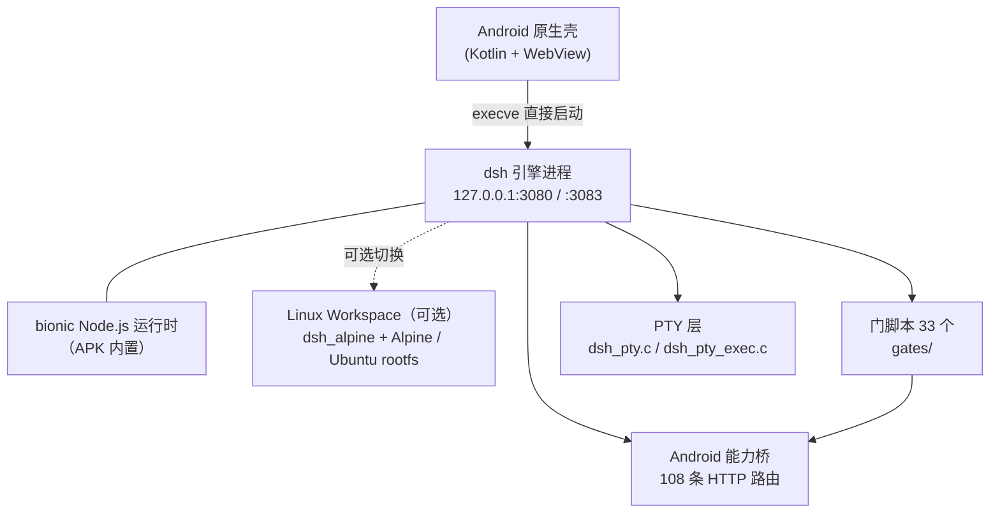

# DSH Mobile · DeepSeek Harness for Android

<p align="center">
  
</p>

<p align="center">
  <b>把完整的 Node.js Agent 引擎，以 Android 原生二进制打进 APK。</b><br>
  不要 Root、不要 Termux、不要电脑。装完即用，冷启动 3 秒级。<br>
  另有可选的 <b>Linux Workspace</b>：一套自研的免 root 用户态容器。
</p>

<p align="center">
  <a href="#-为什么快">为什么快</a> ·
  <a href="#-架构">架构</a> ·
  <a href="#-linux-workspace">Linux Workspace</a> ·
  <a href="#-能力全景">能力全景</a> ·
  <a href="#-路线对比">路线对比</a> ·
  <a href="#-安装">安装</a> ·
  <a href="README_EN.md">English</a> ·
  <a href="README.de.md">Deutsch</a>
</p>

<!-- 徽章区：左边看"有多少人在用"，右边看"项目是否健康"。 -->
[](https://github.com/Soodok/Deepseek-Harness-Local-Android/releases)
[](https://github.com/Soodok/Deepseek-Harness-Local-Android/stargazers)
[](https://github.com/Soodok/Deepseek-Harness-Local-Android/releases/latest)

[](https://github.com/Soodok/Deepseek-Harness-Local-Android/actions/workflows/android-build.yml)


[](https://github.com/Soodok/Deepseek-Harness-Local-Android/commits/main)
[](https://github.com/Soodok/Deepseek-Harness-Local-Android#%E5%8F%8D%E9%A6%88)
[](https://t.me/+4VN3pYyH6i8yNDA1)

---

## ⚡ 为什么快

这是本项目最核心的一条，值得单独讲。

**Android 上的 Agent 方案快不了，原因通常是架构性的。** 它们要么在手机上现搭 Linux 环境（Termux + apt），要么跑一层 proot 容器（glibc rootfs 500 MB～2 GB），要么打包一个冻结的 Termux 快照。这三条路的共同点是——**启动时要做的准备工作太多**：解压 rootfs、挂载伪文件系统、初始化软件源、装载环境变量。

DSH Mobile 走的是另一条路：**没有中间层**。

| 方案 | 跟引擎之间隔了什么 | 冷启动 |
|---|---|---|
| Termux 手动配置 | Perl/bash 启动链 + apt + 环境初始化 | 分钟级 |
| proot 容器 | proot 用户态翻译 + rootfs 解压挂载 | 十几秒～起不来 |
| 冻结快照 | 解压 rootfs → 修补路径 → 启动 | 数十秒 |
| **DSH Mobile（本项目）** | **— 直接 `execve` bionic Node** | **3 秒级** |

关键在于：**我们把 dsh 需要的整套运行时，编译成 Android 原生（bionic）二进制，直接塞进 APK。** 运行时不需要「启动」，它本来就在那儿。冷启动真正做的事只有三件——解压（仅首启一次）、起 Node、等回环端口就绪。

> **注意**：上面这条是**默认的原生模式**。项目另有一条可选的 **Linux Workspace** 路线（见下文），它确实要铺 rootfs、确实比原生模式慢，但它解决的是完全不同的问题——glibc 兼容、`apt`、Linux 包生态。两条路线并存，不是取代关系。

### 实测数字

| 场景 | 设备 | 冷启动到引擎就绪 |
|---|---|---|
| 旗舰真机 | 一加 15T（Android 16） | **3.4 秒** |
| 主流机型 | 各品牌中端 Android | **5 ~ 6 秒** |
| 极端低端 | 紫光展锐手表（**3 GB 内存**） | **13 秒** |
| 模拟器 | x86_64 / 2.5 GB 内存 | **2.2 ~ 2.7 秒** |

作为参照：proot 系方案在不少中低端设备上**直接起不来**，主流机型上平均也要十几秒；Termux 手动配置首次需数分钟。

> 一台 3 GB 内存的紫光展锐手表能跑起来，本身就是架构的证明——同样的内存，proot + glibc 连 rootfs 都铺不开。

### 这些数字是怎么来的

不是调参调出来的，是几个设计决策叠加的结果：

| 设计决策 | 换来了什么 |
|---|---|
| **bionic 原生运行时**，不走 glibc、不套容器 | 省掉 proot 那层用户态翻译，也省掉 rootfs 解压与挂载 |
| 运行时**预置进 APK** | 首次使用无需额外下载，装完即用，离线可启动 |
| `targetSdk = 28`（sideload 策略，与 Termux 同款） | 豁免 Android 10+ 的 W^X 限制，可直接 `execve` 私有目录下的二进制 |
| **CI 收集 + SONAME 去重 + SHA 校验**的运行时流水线 | 每次发布都是可复现产物，不是「我这台机器上能跑」 |
| 全部 `.so` 按 **16 KB 页对齐** | Android 15+ 的 16 KB 页内核设备直接可用 |
| 前端注入 **polyfill** | WebView API 门槛从 Chrome 126 拉回到 **85**，国产 ROM 常见的 96 实测可用 |

---

## 🧱 架构



两条运行路径的差别只有一件事：引擎跑在 **bionic** 上，还是跑在 **Linux rootfs** 里。

---

## 🐧 Linux Workspace

原生模式解决「快」，Linux Workspace 解决「兼容」。它是**可选加装**，默认关闭。

### 为什么需要它

bionic 不等于 glibc。很多 Linux 预编译产物（Clang 的部分工具、某些只发 glibc 构建的 CLI、需要 `apt` 装的开发包）在 bionic 上直接跑不起来。Linux Workspace 就是为了补这一块。

### 它是什么

一套**自研的免 root 用户态容器**，核心是 `app/src/main/cpp/dsh_alpine.c`（原生 C，含 PTY 共约 3900 行）：

| 特性 | 实现方式 |
|---|---|
| 不依赖 ptrace | seccomp BPF 捕获指定系统调用 + `SIGSYS` handler |
| 不依赖 user namespace | 固定基址 `0x2000000000`、`ET_EXEC` 非 PIE、自写 ELF loader |
| 不依赖 `chroot` | 用户态路径翻译，`/proc` `/sys` `/dev` 宿主透传 |
| 不要求 Root | 全程在 App 沙箱内运行 |
| 双向端口映射 | seccomp 同时改写 guest 与 host 侧端口 |

首次启动时 `self-reexec` 完成 guest 用户态接管，之后就是一个正常的 Linux 进程树。

### 两套 rootfs

| 发行版 | libc | 包管理器 | 来源 | 压缩 | 解压 |
|---|---|---|---:|---:|---:|
| **Alpine 3.22** | musl | `apk` | APK 内置 | 3,979,016 B | 8,510,313 B |
| **Ubuntu 24.04 base** | glibc 2.39 | `apt` | 首次联网下载 | 29,936,675 B | 100,784,109 B |

Alpine 随 APK 打包，离线可部署；Ubuntu 首次使用需要下载（四个源：清华 / 阿里 / 中科大 / 官方，sha256 交叉校验）。

### 怎么选

- **要快、要离线、用 `apk`** → Alpine
- **要 glibc、要 `apt`、要跑 glibc-only 的预编译程序** → Ubuntu

两者共用同一个 `dsh_alpine` 加载器，切换只是换 rootfs 目录。

### 实测

| 操作 | 耗时 |
|---|---:|
| 容器启动（`dsh_alpine` 起一个 `node --version`） | **31 ms** |
| Ubuntu 冷启（rootfs 已就绪） | **2.6 ~ 4.2 秒** |
| Alpine 冷启 | **0.1 秒级** |

Ubuntu 比 Alpine 慢一个量级，是发行版自身开销（glibc + init 脚本链）决定的，不是加载器缺陷。

### 已知限制

- **不是安全沙箱**。它保证兼容性和性能，不隔离不可信代码。
- 不支持 X11 / Wayland，图形界面请走本地 HTTP + WebView 预览。
- Ubuntu 精简 base 镜像只有 `gpgv` 没有 `gnupg`，完整 GPG 校验跑不了，所以源码配置带了 `Trusted: yes`。
- `apt-get install` 走三步（`-d` 下载 → `dpkg -i` → `--configure -a`），直接一步式安装会在 seccomp 路径上撞 `cannot stat '/tmp/apt-dpkg-install-XXXX/…'`。

---

## ✨ 能力全景

Android 端注册 **108 条** HTTP 路由（55 条 `/dev/*` + 53 条屏幕/扩展/诊断路由），其中 42 条登记进自描述能力目录（41 个 `/dev` 路径 + `/diag`，`media`/`calendar`/`sms` 各有 GET+POST 故唯一 id 为 39）。另有 **33 个**门脚本（`gates/` 下除 `_dsh_http.sh` 公共库外的可执行入口）与 **23 个**逐项独立的能力开关。

### 屏幕与交互

| 能力 | 入口 |
|---|---|
| 无障碍节点树（结构化，含坐标） | `GET /screen` · `scr dump` |
| 点按 / 手势 / 输入 / 按键 | `POST /tap` `/gesture` `/input` `/key` |
| 截图（**不弹 MediaProjection 授权框**，走 `AccessibilityService.takeScreenshot`） | `GET /screenshot` · `scr shot` |
| 按 viewId 点按 | `POST /tap-id` |
| 弹窗识别（几何判据：底部成对按钮） | `POST /dev/dialog` |
| 动作效果验证 | `POST /dev/verify` |
| 屏幕差异 / 等待静止 | `GET /diff` · `POST /idle` |
| 多步骤闭环执行器（`PICK → ACT → VERIFY → RETRY`，**21 个动作原语**） | `POST /loop/run` · `loop run` |
| 屏幕变化监控（只返回差分指标，不存像素） | `POST /dev/screenwatch` |
| 「AI 的手」可视化（2.5 秒淡出，不吃触摸） | `POST /dev/hand` |

### 设备感知

| 能力 | 入口 |
|---|---|
| 电量 / 温度 / 音量 / 屏幕 / 内存 / 网络 / 前台应用 | `GET /dev/status` |
| 加速度 / 陀螺仪 / 光线 / 距离 / 计步 / 磁场 / 气压 | `GET /dev/sensors` |
| 上下文总线（时间 + 屏幕 + 电量 + 网络 + 前台 + 通知概况 + `should_nudge`） | `GET /dev/context` |
| 传感器场景推断（dark / covered / outdoor / still / moving / walking / running） | `POST /dev/scene` |
| 通知列表 / 通知聚合摘要 | `GET /dev/notifications` · `GET /dev/notify-digest` |
| 通知直接回复（RemoteInput） | `POST /dev/notify-reply` |
| 剪贴板 | `POST /dev/clipboard` |

### 控制

| 能力 | 入口 |
|---|---|
| WiFi / 蓝牙 / 音量 / 亮度 / 手电筒 / 震动 | `POST /dev/control` |
| 媒体会话（播放 / 暂停 / 切歌 / 进度） | `GET/POST /dev/media` |
| 本地提醒 | `/dev/remind` `/dev/remind-list` `/dev/remind-cancel` |
| 地理围栏 | `/dev/geofence` |
| NFC 前台读标签（**无刷写、无卡模拟**） | `GET/POST /dev/nfc` |
| 振动摩斯（A-Z / 0-9 / ok / fail / sos） | `POST /dev/pulse` |
| Doze 白名单 | `POST /dev/doze` |

### 个人数据（四项独立授权）

`/dev/calendar` `/dev/contacts` `/dev/sms` `/dev/calls`

短信写入只拉起系统编辑界面由用户确认，**没有静默代发**。

### 底层射频与网络

| 能力 | 入口 | 需要 Root |
|---|---|:---:|
| 蓝牙 BLE 扫描 / 广播 / GATT / RFCOMM | `POST /dev/bt` | |
| 手机当 BLE 外设（GATT Server + 广播） | `POST /dev/ble` | |
| 手机冒充蓝牙键盘（HID Device） | `POST /dev/bt-hid` | |
| btsnoop 二进制解析（HCI 抓包） | `POST /dev/bt op=log format=binary` | ✅ |
| WiFi 射频扫描 / 链路 / 抓包 | `POST /dev/wifi-radio` | 抓包需 |
| 按 App UID 断网 / 查流量 | `GET/POST /dev/net` | 封锁需 |
| 虚拟 HID 设备（注册为真实键盘鼠标） | `dev hid op=…` | ✅ |

**虚拟 HID 的实测坑**（都写进代码注释了）：`/dev/uhid` 只放 `u:r:ksu:s0`，App 进程打不开；创建设备后必须留 200 ms 等 InputDispatcher 注册；屏幕必须 Awake，否则事件到内核但系统不响应；Consumer 页和 Keyboard 页的 usage 号**不通用**（音量加在 Consumer 页是 233，在 Keyboard 页是 128）。

### 系统级（Root）

`root` 门脚本 19 个子命令：`info` `ps` `kill` `cat` `ls` `rm` `undo` `cp` `mv` `chmod` `chown` `prop` `svc` `pm` `settings` `net` `mount` `journal` `exec`。

四条安全边界：
1. 危险的 `rm` / `exec` / `prop set` / `pm uninstall` 默认 dry-run，要 `confirm=1` 才执行
2. 关键进程保护（`init` / `zygote` / `system_server` / `surfaceflinger` 等）
3. `rm` 进隔离区 `/data/local/tmp/dsh-root-trash/<batch>/`，可 `root undo` 恢复
4. **绝不改 SELinux 策略**（代码里不出现 `setenforce` / `supolicy`）

### 自描述入口

```bash
dev                    # 渲染能力目录（9 组）
dev <能力>             # 看用法
dev <能力> k=v         # 执行
dev api GET /dev/help  # 原始目录 JSON
dev raw                # 真实路由表
```

`dev` 是纯渲染器，从服务端拉目录，不在脚本里硬编码能力名。

### MCP

```bash
dev mcp list      # 42 个工具
dev mcp selftest  # 14 项自检
dev mcp serve     # stdio server
```

工具表从 `/dev/help?detail=1` 派生，新端点自动出现，不用维护第二份清单。

### 应用设置

`GET/POST /dev/settings` 五个 op（`get` / `list` / `set` / `reset` / `reload`），覆盖 15 个 SharedPreferences 文件。

两条边界：凭据键（`lan_web_password` / `pet_pack_index_url`）只返回 `{redacted:true, configured, length}`，不回原文；`cap.*` 能力开关**不在此端点**——那是用户对 AI 的授权，只能由用户在权限中心手动打开。

---

## 🆚 路线对比

| | Termux + apt | proot 容器 | 冻结快照 | **DSH Mobile** |
|---|---|---|---|---|
| 需要 Root | 否 | 否 | 否 | **否** |
| 需要 Termux | 是 | 常需要 | 否 | **否** |
| 冷启动 | 分钟级 | 十几秒起，部分设备起不来 | 数十秒 | **3 秒级** |
| glibc 兼容 | 是 | 是 | 是 | 原生模式否 / **Workspace 是** |
| `apt` / `apk` | `apt` | `apt` | 视快照 | **`apk` + `apt`** |
| 装完即用 | 否 | 否 | 否 | **是** |
| 设备能力接入 Agent | 需自己写 | 需自己写 | 需自己写 | **108 路由 + 33 门脚本** |

> 路线之间不是替代关系：Termux 系是在 Android 上**搭一个 Linux 环境**再跑 dsh；本项目把 dsh 需要的运行时**打进 APK**。**两条路线跑的是同一个 dsh**，差别在启动路径的长度。

---

## 📦 安装

### 1. 确认架构

```bash
adb shell getprop ro.product.cpu.abi
```

`arm64-v8a` 用手机包；`x86_64` 用模拟器包。

### 2. 选包

| 包 | 体积 | 代价 | 适合 |
|---|---:|---|---|
| **完整包**（`-release.apk`） | **~161 MB** | 运行时预置，装完即用、离线可启动 | 绝大多数人 |
| **简单包**（`-noruntime.apk`） | **~34 MB** | 首启联网下载 130.8 MB 运行时（解压后 418.1 MB） | 存储紧张 / 想独立更新运行时 |
| 源码构建 | 视参数 | 需 JDK 17 / SDK 36 / NDK / CMake / Node / Python | 开发者 |

### 3. 首次启动

1. 引导页选语言 / 朝向 / 主题
2. 选运行模式：**普通**（不要 Root）/ Shizuku / Root
3. 等运行时部署（完整包跳过这步）
4. 配模型 API Key
5. 选工作区

第一次可以这样测：**「在当前工作区建个 `hello.js`，写个 HTTP 服务起来，把 127.0.0.1 预览链接发我。」**

### 4. 想操作其他 App

到系统设置里开启 `DSH Screen Tap` 无障碍服务。Android 13+ 还要确认「允许完全控制设备」。**这个权限 App 不能静默打开，必须你手动点。**

---

## 🔧 从源码构建

```bash
# 前置：JDK 17+、Android SDK 36、Node 22、Python 3

# 1) 收集运行时（从 Termux 仓库拉 bionic 包 + 打 Android 补丁）
./scripts/build-runtime.sh --abi arm64-v8a --out dist/runtime-arm64-v8a.zip

# 2) 构建 APK
./gradlew :app:assembleDebug -Pabi=arm64-v8a -Ppackage=full \
  -PruntimeZip="$PWD/dist/runtime-arm64-v8a.zip"

# 输出：app/build/outputs/apk/debug/app-debug.apk
```

Windows Git Bash 用 `gradle.bat` 替代 `./gradlew`。

不打运行时（体积小，首启要下载）：

```bash
./gradlew :app:assembleDebug -Pabi=arm64-v8a -Ppackage=noruntime
```

运行时流水线细节见 [docs/CI_RUNTIME_PIPELINE.md](docs/CI_RUNTIME_PIPELINE.md)。

---

## 📚 深度文档

| 文档 | 内容 |
|---|---|
| [docs/CAPABILITY_MAP.md](docs/CAPABILITY_MAP.md) | 手机能力全量盘点、权限档位、实现状态 |
| [docs/ACCESSIBILITY.md](docs/ACCESSIBILITY.md) | 无障碍控制、视觉兜底、失败恢复 |
| [docs/CI_RUNTIME_PIPELINE.md](docs/CI_RUNTIME_PIPELINE.md) | 运行时收集、去重、校验、发布 |
| [docs/RUNTIME_SWAP.md](docs/RUNTIME_SWAP.md) | 运行时两阶段换装与混合态恢复 |
| [docs/LAN_WEBUI.md](docs/LAN_WEBUI.md) | 局域网 WebUI 代理与验证码 |
| [docs/SSH.md](docs/SSH.md) | SSH 远程工作区 |
| [docs/android-agent-routes.zh.md](docs/android-agent-routes.zh.md) | Android Agent 路线对比长文 |
| [docs/DSHA_GAP_PLAN.md](docs/DSHA_GAP_PLAN.md) | 与其他 Android Agent 的功能差距与路线 |
| [docs/RELEASE.md](docs/RELEASE.md) | 签名、构建、发布流程 |

---

## ⛔ 边界（请知悉）

### 不是端侧大模型

本项目提供 Agent 引擎、Shell、文件系统、设备能力。**模型不在 APK 里**，走你配置的 API 或模型服务。

### 不是安全沙箱

Linux Workspace 也一样。它保证兼容性和性能，**不隔离不可信代码**。Root 模式下 Agent 拥有整个设备的读写能力。

### 静默不了的权限

这些系统不会让 App 静默拿到，必须用户手动确认：

- 无障碍服务（操作其他 App 必须）
- MediaProjection（录屏 / `screenwatch`）
- Android 13+ 的 WiFi / 蓝牙开关
- 部分 OEM 的 HID Profile

遇到时会返回 `user_confirmation_required`，不会把失败伪装成成功。

### 长任务不等于永不中断

前台服务 + 监督器会尽力避免被回收，但这些情况仍然会断：用户强停、极端省电策略、厂商冻结后台（`OplusHansManager` 这类）、设备重启、Root 操作杀进程。被中断的任务要重新派发。

### 读不到的无障碍页面

纯 Canvas、游戏画面、部分 WebView、有保护机制的页面可能没有可用节点树。项目会按层降级：节点树 → OCR → 图标几何 → 帧差。**这仍然不能把所有图形界面变成可靠结构。**

### 不该做的用途

不要把虚拟 HID、无障碍、Root 用于绕过风控、欺骗用户、操作未经授权的设备。项目**不提供**让注入输入「不可检测」的实现。

---

## ❓ FAQ

**Q：需要 Root 吗？**

不要。普通模式下 Agent、工作区、文件、Shell、Node、PTY、插件、多数普通 Android 能力全部可用。Root 只用于 `/dev/uhid` 虚拟 HID、UID 级防火墙、Doze 白名单、系统级进程文件操作。

**Q：Linux Workspace 需要 Root 吗？**

不要。`dsh_alpine` 用 seccomp 在 App 沙箱内加载 rootfs，不依赖 Root / ptrace / user namespace / chroot。

**Q：完整包 161 MB 里装了什么？简单包为什么只有 34 MB？**

完整包把整套 bionic Node.js 运行时打进了 APK——解压后 418.1 MB、15292 个文件（SONAME 去重后 130.8 MB 压缩）。简单包只带 `MANIFEST.json`，首启时按清单去下载同一个 zip。

两者跑的是**完全同一套引擎**，差别只是"运行时在 APK 里还是在网络上"。想省流量选简单包，想装完即用、离线可启动选完整包。

别家的 APK 往往还要多背一个 glibc rootfs（几百 MB～2 GB），我们没有——原生模式不打包 rootfs，rootfs 只在你要用 Linux Workspace 时才下载。

**Q：为什么不做 proot？**

proot 要多一层用户态翻译和 rootfs 解压，直接吃掉启动速度——也就吃掉了低端设备的可用性。我们的 `dsh_alpine` 用 seccomp 做同样的事，但省掉了 ptrace 那一层。`targetSdk 28` 是 sideload 分发策略，与 Termux 同款：豁免 Android 10+ 的 W^X，允许直接 `execve` 私有目录下的二进制。这是冷启动能压到 3 秒的前提之一。

**Q：Alpine 和 Ubuntu 选哪个？**

默认 Alpine（小、离线、快）。要 glibc 预编译程序、要 `apt` 生态、要接近服务器的用户态，选 Ubuntu。Ubuntu 首次要下载约 30 MB、解压约 96 MB，冷启慢一个量级。

**Q：能力「存在」但 Agent 说不知道？**

必须同时满足五条：① 实现注册进 `AgentBridge` ② 登记进 `EndpointCatalog` ③ 对应能力开关已由用户授权 ④ Agent 的环境说明书已升级 ⑤ 运行时已重启加载新说明书。

自检：

```bash
dev
dev api GET /dev/help
dev api GET /dev/routes
```

**Q：怎么从电脑访问手机上的 WebUI？**

设置里打开局域网 WebUI。App 会起代理、生成 6 位一次性验证码、通知栏显示状态。**这暴露的是一个有文件与命令能力的 Agent，只在可信网络用，用完就关。**

**Q：Termux 系和本项目能一起用吗？**

能。跑的是同一个 dsh，差别只在运行层。Termux 适合想完全掌控 Linux 环境的人；本项目适合想装完即用、并且把手机设备能力接进 Agent 的人。

---

## ⚠️ 免责声明

本项目是独立社区项目，与 DeepSeek 官方**没有隶属关系**。

请只在你拥有或明确获授权的设备上使用。普通 / Shizuku / Root 三档拥有完全不同的系统边界；Root 模式下 Agent 生成的命令可能修改或删除系统文件、应用数据、网络规则、设备配置。

使用者自行承担：数据丢失、应用或系统损坏、设备无法启动、账号或服务条款风险，以及 Root / Shizuku / 无障碍 / 自动化带来的后果。

模型服务商的 API 使用、数据处理、计费规则由你配置的服务端点决定。

---

## 反馈

- [GitHub Issues](https://github.com/Soodok/Deepseek-Harness-Local-Android/issues)
- QQ 群：1128769016
- [Telegram](https://t.me/+4VN3pYyH6i8yNDA1)

提 issue 请附：设备型号、Android 版本、CPU ABI、DSH Mobile 版本、当前运行模式、相关权限状态、`logcat`、最小复现步骤、失败原始输出。

---

## 🙏 贡献者

感谢所有提交 Issue、复现日志、真机测试、PR 的贡献者。完整名单见 [GitHub Contributors](https://github.com/Soodok/Deepseek-Harness-Local-Android/graphs/contributors)。

也要感谢上游与生态：DeepSeek Harness、AOSP、Termux 工具链、Node.js、ripgrep、OpenSSH、SQLite、FFmpeg。

---

## 许可证

仓库中除特别声明外（Kotlin、Java、XML、脚本、探针），使用 [MIT License](LICENSE)。

`app/src/main/cpp/dsh_alpine.c` 及其运行时实现使用**专有许可证**，条款见 [dsh-linux-runtime LICENSE](https://github.com/Soodok/dsh-linux-runtime/blob/main/LICENSE)。**专有许可不等同于仓库根的 MIT**。第三方组件原始许可证见 [NOTICE](NOTICE)。

修改 `dsh_alpine` 时必须遵守其专有许可证，且不得引入 GPL / AGPL 或与本项目许可冲突的代码。
