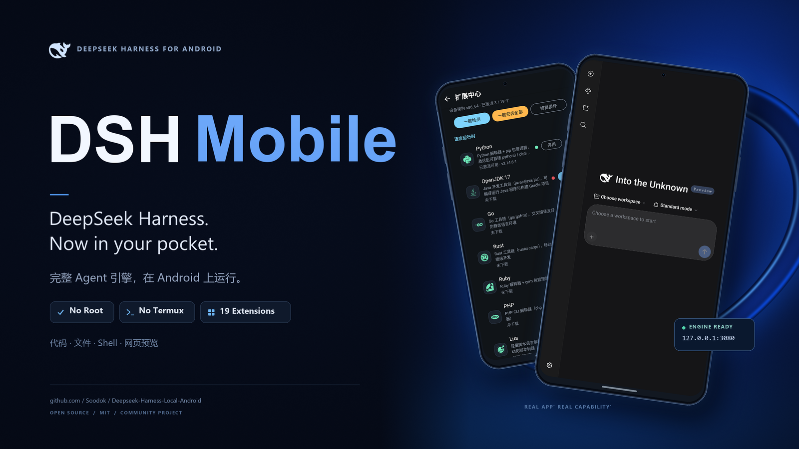

# DSH Mobile

<p align="center">
  
</p>

**The complete Android port of DeepSeek Harness — the official dsh engine running as-is inside the app sandbox. No root, no Termux, no PC needed.**

> 🌐 [中文](README.md) · [Deutsch](README.de.md)


<!-- 徽章区：左边看"有多少人在用"，右边看"项目是否健康"。 -->
[](https://github.com/Soodok/Deepseek-Harness-Local-Android/releases)
[](https://github.com/Soodok/Deepseek-Harness-Local-Android/stargazers)
[](https://github.com/Soodok/Deepseek-Harness-Local-Android/releases/latest)

[](https://github.com/Soodok/Deepseek-Harness-Local-Android/actions/workflows/android-build.yml)


[](https://github.com/Soodok/Deepseek-Harness-Local-Android/commits/main)
[](https://github.com/Soodok/Deepseek-Harness-Local-Android#%E5%8F%8D%E9%A6%88)
[](https://t.me/+4VN3pYyH6i8yNDA1)

[中文](README.md) · [English](#introduction)

---

## Introduction

DSH Mobile is the **complete Android port of [DeepSeek Harness](https://github.com/deepseek-ai/deepseek-harness)** — DeepSeek's open-source Agent framework. A complete Node.js Agent engine runs inside the app sandbox, listening on the `127.0.0.1` loopback — sessions, credentials, and workspaces **stay on your phone**. Install and go; whether model requests leave the device depends on the model service endpoint you configure.

## 🎯 What This Is · What This Is Not

**This is**: the **complete Android port of DeepSeek Harness** (`@deepseek-ai/dsh`). The engine is the official upstream code (pinned to `0.2.1-rc.2`) — plugin system, WebUI, and tool-calling chain all come from upstream. What this project supplies is the Android-side runtime: a self-built bionic Node.js runtime with a verified dependency closure, foreground-service keep-alive, privilege tiers, and the Extension Center. **Anything desktop dsh can do, this can do** — just inside the phone's sandbox.

**This is not**:

- ❌ **Not a self-built AI agent framework** — agent logic, plugin system, and context management all belong to DeepSeek Harness. This project is a **port**, not a replacement, and it does not compete with upstream
- ❌ **Not an on-device LLM app** — no model weights, no local inference. Models are reached through the API endpoint you configure, exactly as with desktop dsh
- ❌ **Not a phone-automation agent** — accessibility screen reading/tapping is **one of the tools** handed to the agent, not the product itself
- ❌ **Not a proot / Ubuntu-container solution** — no Linux container, no distro rootfs. The Node.js runtime and the whole toolchain ship as native Android (bionic) binaries inside the APK: install and go, with no container to initialise

In one line: **looking for a way to run dsh on Android without Termux? This is it.**

## ⚡ Measured Performance

All figures come from real-device / emulator testing, not theory:

| Metric | Measured | Environment |
|---|---|---|
| **Cold start to engine ready** | **3.4 s** | OnePlus 15T (Android 16), real device |
| **Cold start, mainstream phones** | **5 – 6 s** | Mid-range devices from various OEMs |
| **Cold start, weakest device** | **13 s** | Unisoc watch with **3 GB RAM** |
| **Cold start, emulator** | **2.2 – 2.7 s** | x86_64 / 2.5 GB RAM |
| **Memory with parallel services** | **< 400 MB** | Engine + multiple toolchains running together |
| **Android compatibility** | **8.0 → 16** | Requires WebView ≥ Chrome 85 (APIs polyfilled; Chrome 96 verified) |
| **APK size** | **full ~150 MB / lite ~24 MB** | Full bundles Node.js; noruntime downloads it on first launch |
| **Installed size** | **~720 MB** | Runtime unpacks to 404 MB + the app itself |

### Why it is this fast

Most Android agent setups cannot be fast for a **structural** reason: they build a
Linux environment on the device (Termux + apt), run a proot container
(glibc rootfs, 500 MB – 2 GB), or ship a frozen Termux snapshot. All three have to
*prepare* a lot before the engine can start — unpack a rootfs, mount pseudo
filesystems, bootstrap a package index.

DSH Mobile has **no layer in between**:

| Approach | What sits between you and the engine | Cold start |
|---|---|---|
| Termux, manual setup | Perl/bash boot chain + apt + env init | minutes |
| proot + Ubuntu | kernel → proot → glibc → distro → Node | 10 s+, fails on weaker devices |
| Frozen snapshot | unpack rootfs → fix paths → start | tens of seconds |
| **DSH Mobile** | **— straight `execve` of bionic Node** | **~3 s** |

The entire runtime dsh needs is compiled to **Android-native (bionic) binaries and
shipped inside the APK**. The runtime does not need to "boot" — it is already there.
Cold start really only does three things: unpack (first launch only), start Node,
wait for the loopback port.

That a 3 GB Unisoc watch runs this at all is the architecture proving itself:
proot + glibc would not even fit its rootfs in that much RAM.

## ✨ What It Can Do on a Phone

**A real PTY, written in native C**
Web terminals look simple but are the hardest layer here. Upstream
`dsh-subprocess-local` fails twice on Android: its process inspector accepts only
`linux` / `darwin` / `win32` and throws `terminal inspection is unsupported on
platform android` (Termux-built node reports `process.platform === "android"`, not
`linux`), and `node-pty` has no Android prebuilt so the collector substitutes a
stub that throws on first call. We patch the inspector to treat `android` as linux
and wrote **581 lines of C** (`dsh_pty.c` + `dsh_pty_exec.c`, `posix_spawn` +
`openpty`), with node-pty replaced by a shim forwarding to that native helper. The
result is a **real bash terminal** — `top`, `vim`, and other tty-requiring programs
work.

**14 Android adaptation patches — bending a desktop engine onto a phone**
The least visible and most laborious part. Upstream assumes a Linux desktop, and
every such assumption is a crash on Android: the PTY platform check; PTC workers
clearing `LD_LIBRARY_PATH` (Android has no ldconfig, so bionic node cannot find
`libz.so.1`) plus a bootstrap path-mapping fallback; 14 modern Web APIs missing
from old WebViews; filesystem path/permission semantics; `openPath` calling
`xdg-open` / `open` / `start`; attachment URI handling; bash reading
`/data/data/com.termux/...` when Termux is installed; `bin/curl` missing
`LD_LIBRARY_PATH`; and the extension-toolchain variables that silently disable
Python / Perl / Git / ImageMagick / Rust inside PTC. Every patch is **fail-fast**:
if upstream refactoring moves an anchor, the build **aborts** rather than warning —
a missing patch means a feature is broken for users.

**Runtime swap with two-phase commit**
Replacing the runtime cannot be "delete then unpack" (leaves a window where nothing
works) nor a naive rename-every-top-level-entry (any interruption leaves a mixed
old/new tree — and completeness checks do **not** catch it: a new `bin/` with an old
`lib/` passes, because they only verify anchor files and node architecture). Since
v1.4.26 we unpack to `engine.staging`, verify it (anchors + executable bit + **ELF
architecture**), write a **`.runtime-swap` intent journal**, rename entries
one-by-one, keep `engine.old` until the engine first reaches Healthy, and on next
launch detect a half-finished swap and recover. This is two-phase commit applied to
a filesystem; having your background process killed by an OEM is normal on Android,
so without it runtime updates are a gamble. See [docs/RUNTIME_SWAP.md](docs/RUNTIME_SWAP.md).

**Run the full Agent engine on your phone**
The official dsh engine (pinned to `0.2.1-rc.2`) runs in the Android app sandbox with its bionic Node.js runtime and toolchain bundled in the APK. No Root, Termux, PC, or proot/Ubuntu container is required. The Agent can work with files, run shell commands, search text, and manage projects; its engine endpoint listens on `127.0.0.1`.

**Preview results where they run**
The Agent can start a local HTTP service and return a `http://127.0.0.1:port` link. Tap it to preview a page or service on the phone, without moving the project to a computer first.

**Make the phone a real Agent workstation**
The Extension Center offers **19 environment extensions** — including Python, Go, Rust, Clang, OpenJDK, Git, Ruby, PHP, Perl, Lua, SQLite, FFmpeg, ImageMagick, OpenSSH, ADB, and Vim. Install or remove them on demand, with three-state status and inline progress. Dependency closures are resolved automatically, packages are SHA-256 checked and atomically published, and install-time shebang repair helps scripts find their interpreters. Downloads can use direct China mirrors (TUNA → USTC → BFSU → Termux official). The Agent can also install and activate extensions itself; self-installing the Android SDK command-line tools was verified in Root mode.

**Bring the dsh plugin ecosystem along**
Settings → Extensions → **Community plugins** lets you search npm for dsh ecosystem plugins and install or uninstall them in the app. Compatibility-filtered results, progress, and failure reasons make plugin setup visible; installed plugins appear in the WebUI panel. **Plugins extend Agent capabilities; environment extensions provide command-line tools.**

**Built-in SSH remote workspaces: edit code on a server from the phone**
[@xiaopb/dsh-hardssh](https://github.com/XiaoPb/dsh-hardssh) ships by default. CI checks out a pinned GitHub commit at build time and compiles it into the runtime — **the plugin source does not live in this repository**. Open the **SSH workspaces** entry in the left sidebar, add a server (or import `~/.ssh/config`), and bind a remote directory as a workspace; inside that session `read` / `write` / `edit` / `bash` run **on the server**, so editing code, running tests, and reading logs stay off the phone. Local workspaces use the in-app directory browser (Android has no OS folder dialog) — DSH-styled since 0.2.10, with an inline **New folder** action — and the host form can **import or generate an SSH key** and show its public half; keys live in the app-private `.ssh` (0600) or under `Documents/dshdata/ssh`. The right-side **SSH** tab provides an xterm Web terminal, upload/download, local port-forward tunnels, and remote commands. Agent tools include `ssh_list` / `ssh_exec` / `ssh_upload` / `ssh_download` / `ssh_tunnel` / `ssh_cluster` plus `remote_ls` / `remote_search` / `remote_status`. Hosts and credentials stay in app-private storage; the engine still listens only on `127.0.0.1` and remote access is an outbound connection. Upgrade the plugin by bumping `HARDSSH_REF` in `.github/workflows/android-build.yml`. See [docs/SSH.md](docs/SSH.md).

**Operate apps with a verified local loop**
Enable the accessibility service and the Agent can control the phone through **21 action primitives**, including taps, text input, swipes, scrolling and search, gestures, launch/intent, repeat, conditions, and collection. Each step follows **PICK → ACT → VERIFY → RETRY**. Screen understanding layers accessibility nodes, OCR, icon recognition, and frame differences; on failure, it can change its anchor, action, or route and return the failure evidence instead of blindly repeating a tap. Conditional `when` branches, optimistic execution, and scenario memory help it handle variation and reuse successful paths.

The timings are measured: a single closed-loop step takes about **1.45 s** (1.13 s to tap + 69 ms to verify); compact verification takes about **5 ms** and is roughly **1/7** the size of a full JSON dump. The OCR chain takes **326–393 ms**, about **4× faster** than the prior 1370–1588 ms measurement; settle adapts to page state (**355–1566 ms**) rather than waiting a fixed 900 ms. A combined multi-function task completed in **7 calls / 64.7 s**; all **7 noisy test pages** passed, and cross-app browser → Settings → return-to-app tasks run reliably. Fast mode thinks on the first accessibility step only. Human-like curved, slightly varied swipe paths and small randomized tap offsets complement the visual checks.

**Accessibility and background at a glance**
A draggable floating status ball shows engine state and the latest action. From the third consecutive accessibility action, a notification updates with the current step; it disappears after 10 seconds without activity. The Agent can also send task-completion notifications. On exit, the app stops the engine and its separate child processes, closes the screen, and destroys the WebView to release about **380 MB** of runtime memory. See [docs/ACCESSIBILITY.en.md](docs/ACCESSIBILITY.en.md) and [docs/NOTIFICATIONS.en.md](docs/NOTIFICATIONS.en.md).

**Voice input that still works in the background**
Tap the floating-ball microphone to open an editable bottom panel; recognized text appears live and can be corrected before sending to the current conversation. Recognition prefers the system service, then a cloud OpenAI-compatible API; the open-source offline plugin [dsh-asr-service](https://github.com/Soodok/dsh-asr-service) is also available. Android-side timing drives the send path, so it works with the app in the background. WebUI input is read back and de-duplicated. On some devices, a brief 1–2 frame visual remnant may still appear at send time due to system composition. See [docs/VOICE_INPUT.en.md](docs/VOICE_INPUT.en.md).

**Use the native WebUI from a computer over LAN**
Settings → Extensions → **LAN WebUI access** exposes the phone's running WebUI at `http://<phone-IP>:3090` on the local network. Each enable generates a random **6-digit code**, copies it automatically, and displays it once. A persistent notification reminds you while access is on; its Stop button really stops the proxy, including in Normal mode, and exiting the engine stops it too. The app-layer proxy supplies the secure-context features the browser needs (random UUID, loopback checks, `/api` same-origin, and WebSocket upgrade) without modifying engine files. The upstream engine refuses `0.0.0.0` binding; LAN access is an explicit app-level switch. See [docs/LAN_WEBUI.en.md](docs/LAN_WEBUI.en.md).

**Keep data and permissions under your control**
The engine listens only on `127.0.0.1`; sessions, credentials, and workspaces stay in the phone's private storage — whether model requests leave the device depends on the model endpoint you configure.

- Sessions and workspaces live under **`Android/data/app.dsh.mobile/files/dshdata`** on external storage — visible in a file manager and easy to copy as a backup
- Upgrading from an older build **migrates** data automatically (copy → verify entry count → delete the old copy; on a count mismatch the original is kept)
- If the external directory is unavailable the app falls back to private storage (uninstalling then loses data)
- ⚠️ **Note**: `Android/data/` is app-specific external storage and is **removed when you uninstall**. Copy it out regularly if you need it long-term; `profiles/` (which holds credentials) always stays in private storage.

The capability bridge listens only on `127.0.0.1:3083`, uses a random token generated at each launch, and injects it only into the engine environment; another app without the token gets `unauthorised`. Normal mode stays in the app sandbox, Shizuku adds adb-level commands, and Root enables full-device access. In Normal mode, a `su` gate blocks child-process escalation.

**Make narrow-screen UI feel native**
Client-side plugins let the sidebar take the full row in portrait while the conversation flow yields; landscape and wide layouts remain unchanged. Settings reflows vertically with a horizontally scrollable top navigation, and the right-side change/code-diff panel becomes a full-screen overlay on narrow screens. All three use the engine's official `dsh.client` mechanism: no engine-source edits, no overwrite on engine upgrades, and uninstall to restore. Four plugin test suites passed **30, 26, 36, and 28 assertions**. See [docs/NARROW_UI.en.md](docs/NARROW_UI.en.md).

**Three privilege tiers, chosen explicitly**
Normal mode is the sandbox default; options whose capability isn't ready are greyed out, and switching tiers restarts the engine. Shizuku offers adb-level access without Root; Root provides full-device read/write. Choose the smallest permission level that fits the task.

## 📚 Feature deep-dives

Every capability has its own document (design trade-offs, measured numbers, troubleshooting):

| Document | What's inside |
|---|---|
| [Accessibility control](docs/ACCESSIBILITY.en.md) | read/tap/type/swipe/long-press/drag via 21 primitives; layered vision, per-step verification; measured ~1.45 s/step |
| [SSH remote workspaces](docs/SSH.md) | built-in @xiaopb/dsh-hardssh: remote workspaces, web terminal, tunnels, `ssh_*` tools; built from GitHub in CI |
| [Closed-loop design notes](docs/LOCAL_CLOSED_LOOP.md) | design and evolution of the on-device decision engine |
| [Narrow-screen UI plugins](docs/NARROW_UI.en.md) | full-width sidebar / settings reflow / full-screen right panel (three client plugins) |
| [LAN WebUI](docs/LAN_WEBUI.en.md) | reverse proxy, 6-digit code, persistent reminder and stop chain |
| [Voice input](docs/VOICE_INPUT.en.md) | dual recognition channels, send de-dup, panel parking, known issue |
| [Desktop pet](docs/pet/README.md) | plugin-driven system overlay: setup and limits ([guide](docs/pet/PET_GUIDE.md)), bridge and internals ([architecture](docs/pet/PET_ARCHITECTURE.md)), shipped features and next steps ([roadmap](docs/pet/PET_ROADMAP.md)) |
| [Notifications & background](docs/NOTIFICATIONS.en.md) | AI progress, task completion, LAN reminder, clean exit |
| [Complex-scenario field notes](docs/COMPLEX_SCENARIOS.md) | noisy pages, cross-app tasks, failure recovery, measured |
| [Fast-path picker](docs/FAST_PATH_PICKER.md) | on-device UI element selection and discrimination |
| [Release notes archive](docs/release-notes/) | per-release `RELEASE_NOTES_*.md` (v1.3.0+) kept out of the repo root |

## ⛔ Limits (please be aware)

- **WebView must be Chrome 85+ (2020-06 or later)**: the app itself supports Android 8.0 → 16, but the UI renders in the system WebView, and the engine frontend uses modern syntax (`??=`, class fields) — a **parse-time** feature that polyfills cannot patch. Devices whose system WebView is older than Chrome 85 show a blank page (export the log from Settings to confirm: it records the `SyntaxError` and the WebView version). **On Android 8.0+ the WebView is an independently updatable system component** (Google Play / OEM stores), so updating it to 85+ is all it takes; the few Chinese ROMs that can never update their WebView are a known limitation.
- **No desktop environment**: Linux GUI desktop apps can't run; visual outputs are previewed via local HTTP + the built-in WebView
- **Bundled toolchain is node/bash only**: Clang/Python/Go and 16 more environments come through the built-in **Extension Center** (one tap), or the Agent can install them itself (verified in Root mode with the Android SDK)
- **Screen reading is "half-blind"**: `scr dump` reads the accessibility node tree (text + coordinates + clickability), which is useless for pure-graphics or game canvases; complex UI automation stays limited
- **Android 13+ asks for confirmation when enabling accessibility**: for sideloaded apps the system shows an "Allow full control of your device" dialog that must be accepted by hand; writing the setting over adb gets reverted by the system. Follow the in-app guide to the system UI.
- **Long tasks are not immortal**: the foreground service maximally avoids system reclamation, but a force-stop or extreme battery saver can still interrupt (the engine auto-restarts; in-flight tasks must be re-dispatched)
- **Escalation carries risk**: in Root mode the AI has full-device read/write and misoperations can damage the system — see the disclaimer below

## 🌟 What the Termux Routes Can't Give You

Same dsh, different delivery — and every one of the following is engineering this project had to build itself. This is also why it is called a **port** rather than a repack:

**Cross-version compatibility, already paid for**
The app itself supports Android 8.0 → 16; rendering depends on the system WebView and **requires Chrome 85+ (2020-06)** — the engine frontend uses `??=` and friends, a parse-time feature polyfills cannot patch (see Limits). Since many Chinese ROMs can never update their WebView, the build injects a polyfill into the frontend (13 modern APIs including `AbortSignal.any` / `Promise.withResolvers` / `URL.parse`), pulling the API-level floor down from Chrome 126 to 85; every `.so` is **16 KB page-aligned** for modern kernels. On the Termux routes, these are per-device adventures.

**Plugin system works out of the box — no compiler engineering required**
dsh's "everything is a plugin" architecture is preserved as-is: hot plugin loading and JSONL session persistence work exactly as upstream. Missing language environments (Python / Go / Rust / Clang / OpenJDK…) come from **19 one-tap extensions**, with dependency closures pre-resolved in CI and ELF-verified. On the Termux routes, native modules like `sharp` / `koffi` / `node-pty` failing to build is the norm — the community even maintains separate prebuilt-module projects just for this.

**Survives background reclamation, notifies on completion**
specialUse foreground service + exponential-backoff supervisor against system reclamation; long tasks keep running with the screen off, and a system notification fires when a task completes. Keeping a Termux session alive under aggressive Chinese-ROM battery savers is everyone's private superstition.

## 🆚 Routes to Running an Agent on Android

| | Termux manual setup | Termux one-click script | proot + Ubuntu | APK snapshot repack | **DSH Mobile** |
|---|---|---|---|---|---|
| Install experience | Install Termux, configure, install deps | Script does it for you | Install container + distro | Install & go | **Install & go** |
| Runtime form | Live environment (extensible) | Live environment (extensible) | glibc inside a container (extensible) | Dead snapshot, frozen at build | **Self-built bionic closure, collected & verified by CI** |
| License compliance | — | — | — | ⚠️ Snapshot repacks GPL components; compliance questionable | **MIT/BSD/ISC/Zlib components only** |
| Background reliability | Depends on Termux session keep-alive | Same | Same | Watchdog brute force | **specialUse foreground service + exponential-backoff supervisor** |
| Privilege tiers | None | None | None | None | **Three-tier modes + su gate + Shizuku adb bridge** |
| Build engineering | — | Partially reproducible | — | No CI; not reproducible from source | **Dual-arch CI: collect → closure checks → 16KB alignment → APK** |
| First launch | Minutes after manual setup | Minutes after script | Minutes for container init | Minutes to unpack snapshot | **Cold start < 10 s** (measured on device) |
| Old WebView support | — | — | — | — | **polyfill injection** (API floor 126 → 85) |
| Termux dependency | Requires Termux app | Requires Termux app | Requires Termux app | Snapshot *is* Termux | **Zero** (hardcoded paths relocated) |
| Environment extensions | Manual install, extensible | Manual install, extensible | apt, extensible | Dead snapshot, not extensible | **19 one-tap extensions + agent self-install, official icons, three-state management** |
| Cross-version compatibility | Per-device trial and error | Same | Same | Same | **8.0→16 supported + WebView polyfill + 16KB alignment** |
| Plugins usable out of the box | Fight native modules one by one | Depends on the script's patch coverage | Same | Frozen at build time | **CI pre-resolved dependency closure + 19 one-tap extensions** |

> These routes are not replacements for one another: Termux-family solutions **build a Linux environment** on Android and run dsh inside it (advantage: live and freely extensible via pkg/apt); this project **packs dsh's runtime into the APK** (advantage: install-and-go, zero external dependency). **Both routes run the same dsh** — pick by how much setup cost you're willing to pay for a live environment.
>
> 📄 Full write-up of all five routes — mechanics, trade-offs, and how to choose — in **[docs/android-agent-routes.md](docs/android-agent-routes.md)** ([中文](docs/android-agent-routes.zh.md)).

## Privilege Modes

| | Normal | Shizuku | Root |
|---|---|---|---|
| Engine identity | App sandbox | App sandbox | uid 0, full device |
| Agent power | In-sandbox commands | + adb-level commands (`shz`) | Full read/write |
| Prerequisite | None | Install & start [Shizuku](https://shizuku.rikka.app/) | Rooted device |
| Safeguards | su gate blocks escalation | su gate blocks escalation | Double high-risk confirmation + automatic pre-start backup |

Normal mode is the default; choose Shizuku or Root only when the task requires a wider device boundary.

## 📦 Installation

**Download a Release (recommended)**: grab the APK from [Releases](https://github.com/Soodok/Deepseek-Harness-Local-Android/releases) (pick `arm64-v8a` for phones; latest is **v1.4.20**), then install with unknown sources allowed.

> 📦 **Which file to pick**:
> - **Full package** (no `-noruntime` suffix): bundles the Node.js runtime (~150–230 MB), works offline.
> - **noruntime package** (`*-noruntime.apk`): much smaller; on first launch it downloads the runtime
>   from the link in `MANIFEST.json`. It uses the `gh-proxy.org` prefix proxy by default (direct GitHub
>   downloads often fail in some regions); change it or switch to a direct connection under
>   Settings → Extensions → Runtime download proxy. App updates no longer re-download the runtime.
>
> Both variants include the bundled SSH plugin; runtime updates are available under About → Runtime.
> Names ending in **`-debug`** are debug-signed builds; release and debug builds cannot be installed
> over each other. `x86_64` packages are for emulators only.

**Build from source** (JDK 17 + Android SDK, NDK r26+, CMake 3.22.1):

```bash
# Linux/CI: unified runtime pipeline (collect + dedupe + verify + BUILD.json)
./scripts/build-runtime.sh --abi arm64-v8a --out dist/runtime-arm64-v8a.zip

# full package
gradle assembleDebug -Ppackage=full -PruntimeZip="$PWD/dist/runtime-arm64-v8a.zip" \
  -PhardsshDir="$PWD/dist/hardssh"
# noruntime package (no embedded runtime)
gradle assembleDebug -Ppackage=noruntime -PhardsshDir="$PWD/dist/hardssh"
```

The bundled hardssh directory is assembled by `scripts/pack-hardssh.sh` from the upstream Release tgz (npm latest by default).

Alternatively, fork the repo and run the **android-build** workflow on GitHub Actions for a cloud build.

**Requirements**: Android 8.0+ (**WebView ≥ Chrome 85**, see Limits) · arm64-v8a / x86_64 · **1.2 GB+ free storage recommended** for a staged runtime update (full APK ~150–230 MB; runtime unpacks to ~494 MB).

## 🚀 Quick Start

1. On first launch, pick the display orientation and privilege mode (choose **Normal** if unsure)
2. Wait for runtime extraction (real progress) and engine startup
3. Start chatting and hand the Agent tasks; tap the gear for settings; tap any `127.0.0.1` link the Agent gives you to preview its work
4. Voice input and the floating window are always available — no switch needed
5. To let the Agent operate the screen: enable the **DSH Screen Tap** accessibility service in system settings (on Android 13+ the system asks "Allow full control of your device" — tap **Allow**)

## ❓ FAQ

**Does it require Root?** No. Normal mode covers the vast majority of use cases; Root/Shizuku are optional advanced tiers.

**How does this relate to the Termux approach?** Parallel routes, not replacements. The Termux route **builds a Linux environment** on Android (manual setup / one-click script / proot + Ubuntu) and runs dsh inside it; this project **packs dsh's runtime into the APK** (full) or downloads it on first launch (noruntime), so install-and-go stays possible. **Both run the same dsh** — choose by how much setup cost you're willing to pay for a live environment.

**Does it reimplement the agent itself?** No. Agent logic, plugin system, and WebUI all come from the official [`@deepseek-ai/dsh`](https://github.com/deepseek-ai/deepseek-harness); this project only provides the Android-side runtime (bionic Node.js runtime, foreground service, privilege tiers, Extension Center). That is why it is described as a **port**, not a framework.

**Is my data uploaded?** The engine, sessions, and workspace are all local; whether data leaves the device depends on the model service endpoint you configure.

**Why is the APK so large?** The full package bundles the complete bionic Node.js runtime (~494 MB unpacked), the toolchain closure for 19 extensions, and dsh's dependency tree. Since v1.4.20 a **noruntime package** is also published: no runtime inside, app updates are tens of MB, and the runtime is downloaded on first launch and can be updated independently. Termux-family routes keep that setup external and installed by the user, so their package is smaller but first use requires environment setup.

**How does the Agent show me a web page?** Ask it to start a local HTTP server and give you a `http://127.0.0.1:port` link; tap to preview.

**Why can't I enable touch injection?** Android requires accessibility services to be enabled manually in system settings; the in-app button just takes you there. On Android 13+ the first activation also shows a system confirmation dialog ("Allow full control of your device") that must be accepted with **Allow**.

## ⚠️ Disclaimer

> **Please read this section carefully before use.**

1. This software is provided "as is", without warranty of any kind, express or implied. The author shall not be liable for any direct or indirect damages arising from the use, misuse, or inability to use this software.
2. **In Root mode, the engine runs with the highest privilege (uid 0), and commands generated by the AI have full read/write access to the entire device.** The AI may produce erroneous, unexpected, or destructive actions — including but not limited to deleting system files, corrupting partitions, or rendering the device unbootable. **Any device damage, data loss, or warranty void resulting from such actions is the sole responsibility of the user; the author bears no liability whatsoever.**
3. In Shizuku mode the Agent can perform adb-level operations, which carry similar risks of accidental damage; use your own judgment.
4. Use this software only on devices **you own or are explicitly authorized to control**. Consequences of using it on unauthorized devices or for unlawful purposes rest entirely with the user.
5. Root and Shizuku modes are optional. Without them, the Agent is strictly confined to the app sandbox. **If you are unwilling to accept any risk, stay in Normal mode.**

**Installing this app or enabling a high-privilege mode constitutes your acknowledgment that you have read, understood, and accepted all of the above.**

## Feedback

Found a bug or have a feature request? Open an [Issue](https://github.com/Soodok/Deepseek-Harness-Local-Android/issues). For crash reports, please attach the `logcat` output or the engine log available in the app.

**QQ group (Chinese): `1128769016`** — usage questions, release news, and plugin recommendations.

**[Telegram group](https://t.me/+4VN3pYyH6i8yNDA1)** — same purpose, better for users outside mainland China.

Bugs are still best filed as Issues so they don't get lost.

## 🙏 Contributors

This project is not a one-person effort. These people's work is merged into the mainline:

| Contributor | Contribution |
|---|---|
| [@skynit](https://github.com/skynit) | Fixed the login / "Get started" modal render glitch (PR #30): traced it to viewport scaling vs. stale compositor layers, and proposed "finalise viewport under the splash + full-page re-raster" |
| @henryz78 | Fixed the engine getting stuck forever after a restart (v1.4.9): found that the `stopping` flag was never cleared in `start()`, and further identified the race where a swallowed `CancellationException` lets the old supervision loop overwrite the new loop's state. Submitted as a source archive due to network constraints |

## License

[MIT](LICENSE). Runtime components retain their original licenses (MIT / BSD / ISC / Zlib); `@deepseek-ai/dsh` is owned by DeepSeek AI.

This is an independent community project, not affiliated with DeepSeek.
