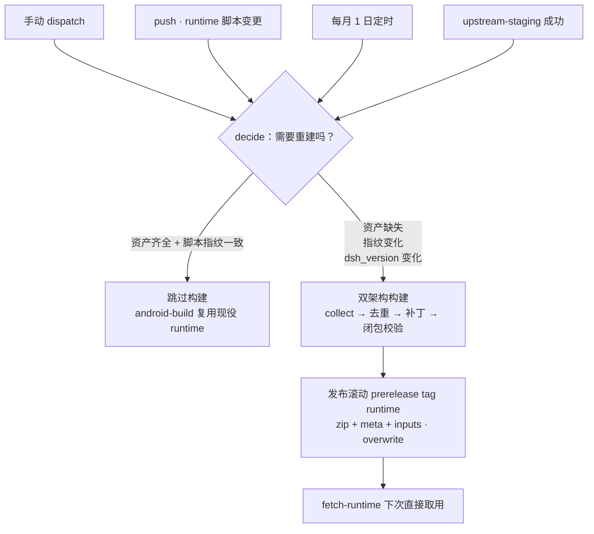
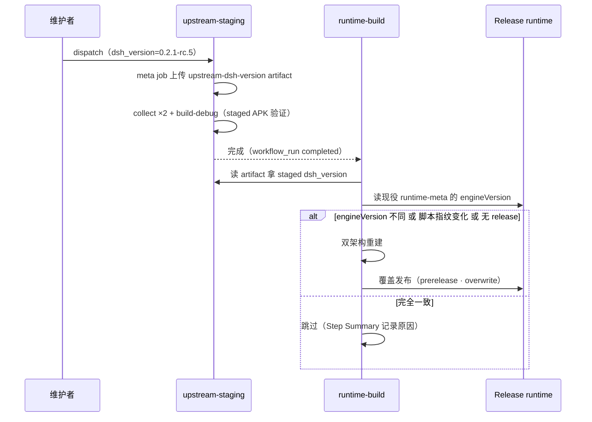
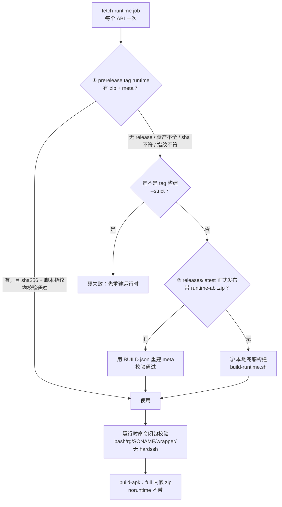

# CI/CD 运行时流水线（runtime-build + android-build）

> 适用版本：v1.4.27 起。相关：`docs/RELEASE.md`（签名与发布）、`docs/RUNTIME_SWAP.md`（端上运行时换装）。
> 对应工作流：`.github/workflows/runtime-build.yml`、`.github/workflows/android-build.yml`、
> `.github/workflows/upstream-staging.yml`；对应脚本：`scripts/build-runtime.sh`、
> `scripts/collect-termux-runtime.sh`、`scripts/fetch-runtime.sh`、`scripts/make-runtime-meta.py`、
> `scripts/runtime-inputs-sha.py`。

---

## 1. 一句话结论

**运行时不再每次 CI 现场编译，但发布出去的东西一个字节都没少。**
`full` APK 照旧内嵌 `runtime.zip`（~146MB），正式 Release 照旧附 2 个 runtime zip
+ `runtime-index.json` + `.sig`。「不重编译」只换了 **runtime.zip 的来源**：从
「每次现场 apt 收集 Termux 闭包」变成「从滚动 prerelease 取一份已验证的产物」。

## 2. 为什么改

| 改造前（v1.4.26 及之前） | 改造后（v1.4.27） |
|---|---|
| 每次 push / PR / 每日定时都跑 `collect-runtime`：apt 收集 Termux 闭包 → 去重 → 打补丁 → 打包 127MB × 2 架构 | 只跑 `fetch-runtime`：`gh release download` 取现成 zip（十几秒） |
| 单次 leg 5–10 分钟，双架构并行也要占满 build-apk 的前置 | 前置耗时 ≈ 下载 + sha 校验，整体 CI 缩短一个量级 |
| Termux 仓库浮动 → 同一 commit 两次构建 sha 可能不同，**不可复现** | runtime 版本与内容 sha 由 runtime release 钉死，**可复现** |
| preview / edge 测的 runtime 与 tag 正式包里的 runtime 可能不是同一份 | 三个通道共用同一份 runtime，**测试即发布** |

## 3. 两条流水线职责

| 工作流 | 职责 | 触发 |
|---|---|---|
| `runtime-build` | **构建** runtime.zip（双架构），发布到滚动 prerelease tag `runtime` | 手动 / runtime 脚本变更 / 每月定时 / upstream-staging 成功 |
| `android-build` | **取用** runtime.zip 打 APK，跑全部产物校验与发布 | push / PR / 每日定时 / 手动（原有逻辑不变） |

> ⚠️ `runtime-build` 的 release 必须 `prerelease: true` + `make_latest: false`：
> GitHub 的 `/releases/latest` 只认正式 release，这样才能保证 App 端 noruntime
> 首启拉取 `releases/latest/download/runtime-index.json` 的渠道不被劫持。
> tag `runtime` 也不匹配 `android-build` 的 `on.push.tags: v*`，不会自激刷包。

---

## 4. runtime-build：什么时候真的需要重建

所有触发都先进入 `decide` job，结论（重建 / 跳过 / 原因 / 版本 / 指纹）写进
Actions 的 Step Summary，不需要点开日志猜。

| 触发 | 决策逻辑 | 是否发布 |
|---|---|---|
| `workflow_dispatch` | 资产缺失 → 重建；脚本指纹变化 → 重建；齐全且指纹一致 → **跳过**（勾 `force` 强制重建） | 是 |
| `push`（runtime 脚本 paths） | 同上；指纹一致就跳过，走 android-build 复用分支 | 仅 `main` 分支 |
| `schedule`（每月 1 日 04:00） | 同上，兜底 Termux 安全更新 | 是 |
| `workflow_run`（upstream-staging 成功后） | 读 staging 的 `dsh_version` artifact，与现役 runtime 的 `engineVersion` 比对：**变了才重建**；dsh 一致但脚本指纹变化也重建 | 是 |



### 4.1 为什么用「脚本指纹」而不是只判断「有没有」

只判断“release 里有没有 runtime”会带来一个静默漏发的坑：

> 改了 `scripts/patch-*.py` → push 触发 runtime-build → 发现 prerelease 已存在 → 跳过
> → 之后 tag 发布时 `fetch-runtime` 取到的还是**旧 runtime**，改动等于没发出去。

因此 `publish` 会把**runtime 构建输入的内容指纹**写进 `runtime-inputs.json`
（`scriptsSha256`），`decide` 下次比对：**资产齐全 + 指纹一致** 才跳过。
指纹由 `scripts/runtime-inputs-sha.py` 计算，覆盖：

```
scripts/collect-termux-runtime.sh
scripts/build-runtime.sh
scripts/dedupe-runtime.py  scripts/dedupe-zod.py
scripts/trim-runtime.py    scripts/make-lite-runtime.py
scripts/patch-*.py（全部补丁脚本）
```

算法：文件按路径排序，逐行 `路径:文件sha256` 拼接后再整体 sha256 —— 与平台、
mtime、git 状态无关，跨 run 稳定。

### 4.2 upstream-staging 的 dsh_version 怎么传过来

`GITHUB_TOKEN` 触发的 `workflow_dispatch` **不会**产生新的 workflow run，所以不能
“staging 里直接 dispatch runtime-build”。改用 artifact 传参：



---

## 5. android-build：fetch-runtime 三级兜底



| 级别 | 来源 | meta 来源 | 典型场景 |
|---|---|---|---|
| ① | `releases/download/runtime/runtime-<abi>.zip` | 同 release 的 `runtime-meta-<abi>.json`，**校验 sha256 一致 + 脚本指纹一致** | 日常 CI（99% 命中） |
| ② | `releases/latest`（正式 v 版）里的 `runtime-<abi>.zip` | 无 meta 资产 → 从 zip 内 `BUILD.json` + 文件哈希重建（`make-runtime-meta.py`） | 尚未跑过 runtime-build 的仓库 / runtime release 被误删 |
| ③ | 本地 `build-runtime.sh` | 脚本自带写出 | 新 fork bootstrap、前两级同时失效 |

三级取货**统一走 `gh api`（api.github.com）下载资产**，不使用 `gh release download`：
后者在本仓库的 **android-build runner 上对 prerelease 标签整体失败**（实测 tier1/tier2
全部降级到 tier3 本地编译，白白多烧一次构建），而 `runtime-build` 的 `decide` 用 `gh api`
读同一份 release 元数据却能成功 —— 说明 api 路径可用、CDN 下载路径不通。故
`fetch-runtime.sh` 改用 `api_asset()` 封装（`gh api <release> --jq 取资产 url` →
`gh api <asset-url> -H "Accept: application/octet-stream"`），与 decide 完全对齐。
`api_asset()` 对 `latest` 与 `tags/<tag>` 都适用，且只下载匹配名称的资产，不会误取
preview/edge/runtime 之外的滚动包。

### 5.1 新鲜度：`--expect-sha` 与 `--strict`

sha256 只能证明「zip 与 meta 同源」，不能证明「这个包是按当前脚本构建的」。
改了 `patch-*.py` 而 prerelease 还是旧产物时，① 级会静默命中，一路走到
`prepareRuntimeAssets` 才报 `runtime lacks the PTC patch` —— 文案指向补丁，
实际问题在取货。所以：

- **`--expect-sha <64hex>`**：比对包内 `runtime-inputs.json` 的 `scriptsSha256`
  与当前仓库指纹（`runtime-inputs-sha.py`，由 workflow 算好传入）。不一致 → 降级并告警。
- **`--strict`**：仅 tag 构建传。① 级拿不到「与本 tag 脚本一致」的产物时**直接失败**，
  禁止降级到 ②③ —— ② 会随 `releases/latest` 漂移、③ 现场编译结果不稳定，都会让
  同一个 tag 在不同时间构建出不同 runtime，正式发布就不可复现了。
  失败信息里直接写了处置动作：`runtime-build` → Run workflow（勾 force）→ 重跑。

> ② 级（releases/latest）现在也复用同一套新鲜度判据：若指定了 `--expect-sha` 且该
> stable 发布含 `runtime-inputs.json` 但与当前脚本不符，**非 strict 会降级到 tier3
> 本地重建**（重建产物与当前脚本一致，比静默用旧包更正确），**strict 直接失败**。
> 这是 v1.4.36 之后的补强 —— 此前 ② 级命中即采用、完全不验指纹，会静默打包一份旧 runtime。

三级产物都要过同一段闭包校验，安全网没有因为“复用”而变薄：

- `bin/bash`、`bin/rg`、`bin/pnpm`、`bin/curl`、`usr/bin/.keep`
- SONAME 精确文件名（`libreadline.so.8` 等 6 个，Android linker 按 NEEDED 逐字查找）
- `@vscode/ripgrep-android-<arch>` 存在，且不混入宿主 Linux ripgrep
- runtime 内**不得**出现 `@xiaopb/dsh-hardssh`（v1.4.20 已解耦到 APK 内置目录）
- PTC 补丁 6 个标记（含 `[dsh-android] bootstrap path fallback`）与 WebView
  polyfill v4 的 4 个标记 —— `runtime-build` 发布前与 `build.gradle.kts` 打包前
  各验一遍，坏包不会进滚动 tag
- **去重内容**（无嵌套 zod、10 锚点、corepack 完好、文件数 < 20000）——
  `runtime-build` 发布前由「校验运行时去重内容」步骤验证（承接探针第 2 节）

### 5.2 取货机制修复的构建耗时收益（实测）

v1.4.36 之后把 `fetch-runtime` 的取货从 `gh release download`（CDN）改成 `gh api`
（见 5 节与 commit `1ed1553`），根治了「prerelease 识别失败 → 掉 tier3 本地编译」的
降级。下面是同一仓库、同一 `android-build.yml` 在修复**前 / 后**两次 push 的真实耗时
（关键路径上的 `fetch-runtime` 是瓶颈）：

| 阶段 | 修复前（tier3 本地编译兜底） | 修复后（tier1 预构建下载） | 节省 |
|---|---|---|---|
| fetch-runtime (aarch64) | **2m 56s** | **26s** | **2m 30s** |
| fetch-runtime (x86_64)  | 2m 12s | 24s | 1m 48s |
| build-apk（4 个 matrix，并行） | 5m54s / 5m34s / 5m40s / 4m24s | 5m50s / 5m04s / 7m53s / 5m16s | 基本不变（run-to-run 抖动） |
| publish-edge | 13s | 25s | — |
| Build monitor | 3s | 5s | — |

> 两个 `fetch-runtime` 是 matrix 并行，不互相叠加；瓶颈取较慢的 aarch64 那条。
> 所以**单次 CI 墙钟时间约减少 2m30s**，与「每次 CI 构建省 ~2 分钟」一致——前提是没有
> 改 runtime 脚本（改了会触发 `runtime-build` 重建，那次另算，见第 4 节）。

**修复前**（fetch-runtime 走 tier3，每条 ABI 现场编译 ~2-3 分钟）：


**修复后**（fetch-runtime 命中 tier1 prerelease 下载，每条 ABI 约 25s）：


之所以能省下这两分钟：tier3 本地编译要 `apt` 收集 Termux 闭包 + 打补丁 + 打包
127MB×2，而 tier1 只是下载已经发布好的 `runtime-<abi>.zip`（~133MB）。下载走
`api.github.com` 比现场编译快一个量级，且 sha256 + 脚本指纹都在发布侧验过，
不会牺牲「同一 commit 两次构建一致」这条不变式。

### 5.3 回归探针的职责切分（_test_runtime_dedupe.py）

`_test_runtime_dedupe.py` 原本把「源码契约」和「产物质量」揉在一个文件里。
i18n-check 是一个**轻量、无 Android SDK、几秒跑完**的门禁，其设计前提就是
「干净检出、没有任何运行时产物」。而：

- `app/src/main/assets/runtime.zip` —— PR #48 后**不再入库**，改由
  `build/generated/runtimeAssets` 注入；
- `_rel/x86_64-dedup.zip` —— 发布产物，从不入库；
- `_runtime_bak/rt-x86_64-zodded.zip` —— 本机构建中间产物，不入库。

所以在 CI 干净检出下，三处源必然都不存在。**把这种必然出现的正常态判成失败是错的**，
而且「为了喂探针去下载一个 100MB+ 的运行时」直接毁掉 i18n-check 的轻量定位——
check 只做检查，下载不合适。

因此改为按性质切分：

| 项 | 检查什么 | 需不需要产物 | 在哪跑 |
|---|---|---|---|
| 第 1/4 节 | 构建脚本有没有接好去重、幂等声明 | ❌ 纯读源码 | i18n-check（始终跑） |
| 3b 的 gradle 静态项 | 构建期有没有强制校验 PTC 门禁 | ❌ 纯读源码 | i18n-check（始终跑） |
| 第 2 节（去重内容） | 无嵌套 zod / 锚点 / corepack / 文件数 | ✅ 必须 | **runtime-build 发布门禁** |
| 3b 的 PTC 内容项 | 补丁内容在不在 | ✅ 必须 | **runtime-build 发布门禁** |
| 第 3 节（zod 版本） | 顶层 zod 版本号 | ✅ 必须 | **runtime-build 发布门禁** |

i18n-check 里：无产物时，上述三项产物检查整体 **SKIP（不计入失败）**，本机有
`_runtime_bak/`（或 `_rel/`）时仍全量校验，不丢本地守卫。产物质量统一由
`runtime-build` 在「刚造出来、准备发布」的那一刻一票否决——这反而比改之前更强：
过去 CI 下这些产物项**从没真正跑起来过**（一直走不到），现在首次在 CI 真正生效。

> 注：该探针是上游文件，我们在 fork 内改了会与上游 diverge。但我们的运行时架构
> （预构建复用 + `_rel` / `_runtime_bak`）本来就与上游不同，上游自己的 i18n-check
> 也一直红着（同一个探针、同一个轻量工作流，干净检出下三处源都没有），所以在 fork
> 内修是合理的。

---

## 6. 资产地图

| Release | 类型 | 资产 | 说明 |
|---|---|---|---|
| `runtime` | prerelease | `runtime-arm64-v8a.zip`、`runtime-x86_64.zip`、`runtime-meta-*.json` ×2、`runtime-inputs.json` | 滚动覆盖，只保留最新一版；**CI 构建源** |
| `preview` | prerelease | 8 个 APK | 每日定时 |
| `edge` | prerelease | 4 个 noruntime APK | push main |
| `v<major>.<minor>.<patch>` | 正式 | 8 APK + 2 runtime zip + `runtime-index.json` + `.sig` | 只认严格 tag；`/releases/latest` 指向它 |

正式 Release 的 runtime zip 就是 `fetch-runtime` 取到的那份，`runtime-index.json`
用同一份 meta 生成并用正式 keystore 签名，因此 **index 里的 sha 与实际打包的
runtime 天然一致**，`publish-release` 无需改动。

---

## 7. 运维手册

### 7.1 强制重建运行时

Actions → **runtime-build** → Run workflow：

- `dsh_version`：要嵌入的 dsh 版本（默认 `0.2.1-rc.5`）
- `force`：勾上 → 跳过一切检查，无条件重建并覆盖发布

```bash
# 等价 CLI（gh 已登录）
gh workflow run runtime-build.yml -f dsh_version=0.2.1-rc.5 -f force=true
```

### 7.2 改了 runtime 脚本，但不想等 push 流程

push 到 `main` 且只改了 runtime 脚本时，`decide` 会因指纹变化自动重建并发布，
一般不需要手动操作。若 push 发生在非 `main` 分支，只构建不发布（避免未审核改动
进入共享 runtime）；确认无误后按 7.1 在 `main` 上 dispatch 一次即可。

### 7.3 看不到步骤结论

每次 `runtime-build` 的 `decide` job 都会写 Step Summary：

```
| 事件 | push |
| 重建 | true |
| 发布 | true |
| dsh（现役 → 目标） | 0.2.1-rc.5 → 0.2.1-rc.5 |
| 脚本指纹（现役 → 本地） | a6dbecab… → 5f21c8d0… |
| 原因 | runtime 脚本指纹变化 → 重建 |
```

`fetch-runtime` 也会在 Step Summary 写一行 `source: ...`，一眼看出本次用的是
prerelease / latest / 兜底构建。

### 7.4 常见故障

| 现象 | 原因 | 处理 |
|---|---|---|
| `fetch-runtime` step 报 `tier 1/2 不可用` 但最终成功 | 正常降级 | 看 Step Summary 的 `source:` 行；若长期落到 tier 2/3，说明 runtime release 缺失，dispatch 一次 runtime-build |
| CI 变慢回到 5-10 分钟 | 落到了 tier 3 兜底构建 | 同上：检查 `runtime` release 是否存在、资产是否被误删 |
| tag 包里 runtime 还是旧的 | runtime 脚本改动后未重建，且指纹未生效（release 里没有 `runtime-inputs.json` 的旧包） | 手动 dispatch + `force=true` 重建后再重跑 tag 构建 |
| tag 构建报 `tier 1 未提供与当前脚本一致的 runtime（strict 档禁止降级）` | tag 构建要求 runtime 与本 tag 脚本指纹一致，prerelease 落后了 | 按提示先 dispatch `runtime-build`（勾 force）发布，再重跑 tag 构建。**不要**改成降级 —— 那会让同一个 tag 内嵌不同 runtime |
| `fetch-runtime` 日志出现 `指纹不一致 — 现役 xxx vs 本地 yyy` | 改了 runtime 脚本但滚动 tag 还是旧产物 | 预期降级行为（非 tag 构建）；确认没意外取到旧包即可，正式发版前仍需重建 |
| `runtime-build` decide 报 `dsh 版本变化` 每次触发 | staging 的 `dsh_version` 与 release 的 `engineVersion` 不一致（如 staging 用了非默认版本） | 属预期：会重建一次，之后比对一致即跳过 |
| `publish` 报 `fail_on_unmatched_files` | 构建产物没齐（某个 ABI 失败） | 看 `build` job 哪个矩阵腿红，修正后重跑；`fail-fast: false` 保证另一腿仍产出 |
| 新 fork 首次 CI 就红在 runtime | 无 `runtime` release、`releases/latest` 也没有 runtime 资产 | 兜底构建本应接管；若仍失败看 `build-runtime.sh` 的 apt 报错（Termux 索引包名漂移） |

---

## 8. 不变式（改代码前先读）

1. **`full` APK 必须内嵌 runtime.zip**，`noruntime` 必须没有 —— 由
   `scripts/verify-apk-assets.py` 与 Gradle 的 `prepareRuntimeAssets` 双重把关。
2. **runtime release 永远 `prerelease: true` + `make_latest: false`**，否则 App 端
   `/releases/latest` 的 index 渠道会被劫持。
3. **runtime.zip 与 runtime-meta.json 的 sha256 必须一致**，`fetch-runtime` 与
   `publish` 两侧都校验。
4. **runtime 内不得含 `@xiaopb/dsh-hardssh`** —— 已解耦到 APK 内置目录，注入逻辑
   卷土重来会导致云端运行时重装丢插件。
5. **三级来源都必须过同一套闭包校验**，不允许“因为复用了就跳过校验”。
6. **tag 构建必须与 runtime 脚本指纹对齐**（`--strict`），禁止降级到
   `releases/latest` 或现场编译 —— 否则同一个 tag 在不同时间构建会内嵌不同的
   runtime，正式发布不可复现，正是本方案要消除的问题。
7. **i18n-check 的运行时探针只验静态契约**：去重内容 / PTC 内容 / zod 版本等
   产物质量项，在「无运行时产物」的干净检出下 SKIP（不计入失败），由
   `runtime-build` 的发布门禁承担。CI 干净检出处红，不代表回归——那是检查放错了
   位置，已从探针移走。
